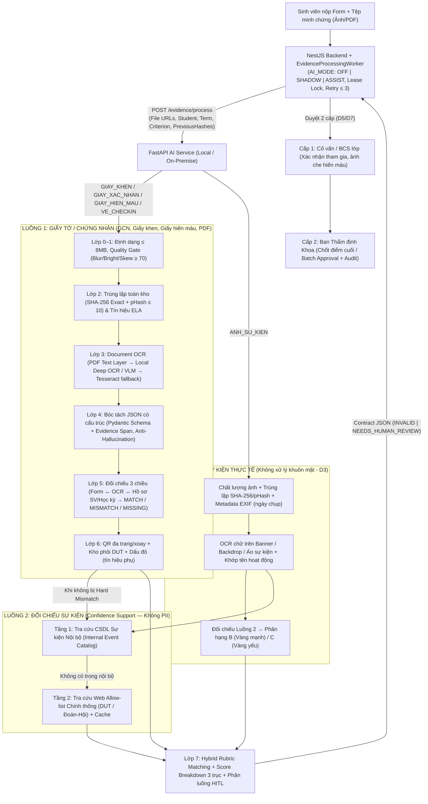

# 01. Kiến trúc tổng thể, Luồng xử lý & Quyết định AI (UniProof-AI)

> **Vai trò tài liệu:** Nguồn chân lý duy nhất (Single Source of Truth) về phạm vi bài toán AI, kiến trúc hệ thống, 3 luồng xử lý, hợp đồng API và 10 quyết định bất biến (`D1–D10`).  
> **Cập nhật:** 22/11/2026 (đối chiếu trực tiếp với codebase `apps/ai-service`, `apps/backend`, `apps/web`).

---

## 1. Bản chất bài toán AI trong UniProof-AI

UniProof-AI là hệ thống **Hỗ trợ Thẩm định Minh chứng Điểm rèn luyện có con người quyết định cuối (AI-Assisted Verification — Human-in-the-Loop / HITL)**.

- **AI KHÔNG thay cán bộ ra quyết định pháp lý:** AI tuyệt đối không có quyền ghi trạng thái `APPROVED` hay `REJECTED`. Quyết định chính thức luôn thuộc cán bộ có thẩm quyền, có căn cứ và được ghi nhận trong `AuditLog`.
- **AI làm đúng 4 việc để giảm tải 60–80% công sức rà soát:**
  1. **Đọc & chuẩn hóa tài liệu** (Chất lượng ảnh → OCR tiếng Việt → Bóc tách thực thể JSON theo schema).
  2. **Đối chiếu nhất quán 3 chiều** (Form sinh viên khai ↔ Dữ liệu đọc từ minh chứng ↔ Hồ sơ SV/Học kỳ + Kho trùng lặp).
  3. **Tìm bằng chứng hỗ trợ** (Mã QR trên chứng nhận, CSDL sự kiện nội bộ, nguồn công khai thuộc allow-list chính thống).
  4. **Đánh giá mức khớp tiêu chí Rubric & phân luồng hàng chờ** (Đánh dấu rõ lỗi mâu thuẫn, điểm nghi vấn, trích đoạn bằng chứng để cán bộ duyệt nhanh).

---

## 2. Đánh giá hiện trạng thực tế (Đối chiếu Codebase)

Khung microservice và tích hợp Backend–AI đã dựng xong ở mức prototype, nhưng phần **lõi AI thực thụ vẫn đang là heuristic/rule-based** và còn nhiều điểm nghẽn:

| Thành phần | Hiện trạng trong code | Điểm nghẽn thực tế |
|---|---|---|
| **Kiến trúc service** | `apps/ai-service` (FastAPI) cung cấp `/api/v1/evidence/inspect` và `/evidence/process`; `apps/backend` có `EvidenceProcessingWorker` (lease lock, retry 3 lần, `AI_MODE`). | Đã nối end-to-end cơ bản; `apps/ai-service/model/` và `predictor.py` đang **rỗng** (chưa có ML/DL model thực tế). |
| **Lớp 0–1: Chất lượng ảnh** | `quality_forensics.py`: Laplacian blur (70%), độ sáng (20%), góc nghiêng (10%), cổng dừng `< 70`. | Ngưỡng mặc định chưa hiệu chuẩn theo phân bố ảnh chụp điện thoại thực tế. |
| **Lớp 2: Trùng lặp & ELA** | Tính SHA-256, pHash (Hamming ≤ 10), ELA (`> 0.25`). Worker gửi `previousHashes` từ `AiPipelineRun`. | Chưa có index chuyên biệt xuyên học kỳ; ELA hay báo giả (false positive) với ảnh nén từ Zalo/Messenger nên chỉ dùng làm tín hiệu phụ. |
| **Lớp 3: OCR tiếng Việt** | `ocr_extractor.py`: PDF text layer + Tesseract 5 (`vie+eng`) chạy 3 nhánh tiền xử lý (`original_gray`, `contrast_upscaled`, `adaptive_threshold`) + phát hiện bất đồng (`recognitionAmbiguous`). | **Điểm nghẽn số 1:** Trên 17 mẫu pilot (`pilot_ocr_error_analysis.json`), **CER đạt 41.9%** ngay cả ở ảnh chất lượng `PASS` (và 77.1% ở ảnh `REVIEW`); lỗi mất dấu tiếng Việt (`à→a`, `đ→d`, `ậ→a`) và nền hoa văn/dấu đỏ rất nặng. |
| **Lớp 4: Trích xuất thực thể** | Regex + heuristics trong `ocr_extractor.py`, validate bằng Pydantic (`schemas.py`). | Rất giòn khi OCR nhiễu; chưa có bằng chứng vị trí (bounding box/span) cho từng trường. |
| **Lớp 5: Đối chiếu 3 chiều** | So khớp tên (`≥85%` PASS, `70–84%` REVIEW, `<70%` MISMATCH), MSSV, CCCD (hiến máu), ngày cấp trong học kỳ (`Term`). Phân biệt rõ `MISSING` và `MISMATCH`. | Phụ thuộc sống còn vào độ chính xác đầu vào từ Lớp 3–4. |
| **Lớp 6: Phôi, Dấu đỏ & QR** | `template_matcher.py` (pHash + aspect ratio), `inspect_document_marks` (heuristic dấu đỏ/chữ ký), `qr_verifier.py` (OpenCV QR trên ảnh đầu). | `templates/registry.json` đang **rỗng (`[]`)** → gần như mọi hồ sơ bị giữ ở trạng thái `REVIEW`/`NOT_CHECKED` và **kẹt trần điểm 89**. QR chưa quét đa trang PDF hoặc ảnh xoay/nhỏ. |
| **Lớp 7: Rubric & Điểm tin cậy** | `criterion_evaluator.py` so khớp từ khóa cứng; điểm tin cậy cộng tuyến tính (`base 35 + ...`, trần 89 khi còn mục chưa xác minh). | Keyword cứng bỏ sót nhiều cách diễn đạt tự nhiên; chưa có phân loại ngữ nghĩa; điểm tin cậy chưa được hiệu chuẩn. |
| **Luồng 2: Tra cứu công khai** | `web_search_verifier.py`: DuckDuckGo HTML, mặc định chỉ nhận allow-list `dut.udn.vn,udn.vn` (`ALLOW_ALL_PUBLIC_SOURCES=False`). | Phụ thuộc scraping HTML DuckDuckGo (dễ bị rate-limit/đổi DOM), chưa có CSDL sự kiện nội bộ làm tầng tra cứu ưu tiên số 1. |
| **Luồng 3: Ảnh sự kiện & Duyệt 2 cấp** | `FACE_MATCHING_ENABLED=False` (đã tắt hoàn toàn Haar/detection); có EXIF + scene OCR. | Chưa có quy tắc phân hạng B/C chuẩn khi không dùng mặt; chưa triển khai workflow duyệt 2 cấp (Cố vấn/BCS → Khoa) & che ảnh hiến máu (`M6`). |

---

## 3. Mười quyết định kiến trúc & pháp lý bất biến (`D1–D10`)

Mọi thiết kế và triển khai AI mới đều phải tuân thủ nghiêm ngặt bảng quyết định sau:

| ID | Nội dung quyết định | Trạng thái | Ràng buộc kỹ thuật bắt buộc |
|---|---|---|---|
| **D1** | **Tra cứu nguồn công khai dùng allow-list** | ĐÃ QUYẾT ĐỊNH | Mặc định chỉ nhận domain chính thức (`dut.udn.vn`, `udn.vn`, Đoàn–Hội). Nguồn ngoài tắt mặc định (`ALLOW_ALL_PUBLIC_SOURCES=false`). Mức cộng: Chính thống tối đa `+20`, nguồn ngoài `+10`, mạng xã hội tối đa `+5` (tín hiệu yếu). Query **chỉ gồm** tên hoạt động, năm, đơn vị — **tuyệt đối cấm** họ tên/MSSV/CCCD. |
| **D2** | **Trần điểm 89 khi còn bước chưa xác minh** | ĐÃ QUYẾT ĐỊNH | Điểm thô ≥ 90 bị hạ trần về `89` (`YELLOW_STRONG`) nếu còn bất kỳ bước xác thực nào ở `REVIEW` hoặc `NOT_CHECKED` (trùng lặp, phôi, ELA, nguồn, danh tính). Chỉ được xếp `GREEN (≥ 90)` khi mọi kiểm tra liên quan đã triển khai và `PASS`. |
| **D3** | **Tắt toàn bộ xử lý khuôn mặt mặc định** | ĐÃ QUYẾT ĐỊNH | `FACE_MATCHING_ENABLED=false` mặc định. Không detect, không Haar/MTCNN, không embedding/vector, không trả count/tọa độ mặt. Checker mặt trả `NOT_CHECKED`. |
| **D4** | **Sinh trắc học khuôn mặt thật** | **BLOCKED** | Chỉ cân nhắc bật nhận dạng mặt khi Nhà trường phê duyệt bằng văn bản về cơ sở pháp lý, consent, mã hóa, retention/xóa và audit. |
| **D5** | **Phân quyền duyệt 2 cấp & bảo vệ giấy hiến máu** | ĐÃ DUYỆT | Cấp 1 (Cố vấn học tập / BCS lớp) chỉ xác nhận tham gia; Cấp 2 (Ban thẩm định Khoa) chốt điểm cuối. BCS lớp **không được xem ảnh gốc giấy hiến máu** — chỉ xem ảnh đã che (CCCD hiện 3 số cuối, ẩn lượng máu & ngày sinh) và API không trả OCR gốc nhạy cảm. Ảnh gốc chỉ qua endpoint kiểm quyền / signed URL ngắn hạn; Cố vấn mở ảnh gốc bắt buộc nhập lý do và ghi audit `(actor, hồ sơ, thời điểm, lý do)`. |
| **D6** | **Score breakdown minh bạch, không gọi là xác suất** | ĐÃ GHI NHẬN | Một cơ chế breakdown thống nhất theo trọng số cấu hình; mỗi thành phần ghi rõ nguồn, trạng thái và điểm đóng góp. Không gắn nhãn điểm heuristic là "xác suất đúng" hay "độ chính xác AI". |
| **D7** | **Ảnh sự kiện luôn HITL & điều kiện Batch Approval** | ĐÃ GHI NHẬN | Ảnh cá nhân/sự kiện **không bao giờ** tự `APPROVED`. Phê duyệt hàng loạt (Batch) chỉ dành cho cấp Khoa, chỉ áp dụng cho hồ sơ đã có xác nhận Cấp 1 và không có cảnh báo; ghi audit riêng từng hồ sơ. |
| **D8** | **Chưa gửi ảnh ra Vision LLM bên ngoài** | CHỜ XÁC NHẬN | Không gửi ảnh minh chứng lên API Vision LLM bên ngoài khi chưa duyệt provider, chính sách retention và bảo mật. **Được phép** dùng Vision/OCR model chạy **hoàn toàn nội bộ (on-premise/local)** nếu không gửi dữ liệu ra ngoài. |
| **D9** | **Không gửi OCR chứa PII ra LLM bên ngoài** | ĐÃ QUYẾT ĐỊNH | `EXTERNAL_LLM_EXTRACTION_ENABLED=false` mặc định. Lớp 4 dùng rule/schema hoặc **model chạy local nội bộ**; không gửi họ tên/MSSV/CCCD/dữ liệu sức khỏe ra API LLM bên ngoài. |
| **D10** | **Chế độ vận hành AI (`AI_MODE`)** | ĐÃ QUYẾT ĐỊNH | `AI_MODE=OFF \| SHADOW \| ASSIST` (mặc định `OFF`). `OFF`: giữ nguyên luồng tiền AI; `SHADOW`: chạy nền và lưu `AiPipelineRun`, không hiện UI/không đổi trạng thái hay thứ tự queue; `ASSIST`: hiển thị gợi ý & checklist cho cán bộ, quyền quyết định vẫn hoàn toàn thuộc con người. |

> **Lưu ý rủi ro Audit:** `Review.rejectBasis` và `AuditLog.newValue.reason` hiện lưu nguyên văn nhận xét của cán bộ. Cần giới hạn độ dài DTO (≤ 500 ký tự), cảnh báo không nhập PII/CCCD/dữ liệu sức khỏe vào ô ghi chú và ưu tiên mã lý do chuẩn hóa.

---

## 4. Kiến trúc tổng thể & 3 Luồng xử lý chuẩn hóa



### Quy tắc định tuyến kết quả AI (State Machine Contract)

| Kết quả AI | Điều kiện kích hoạt | Trạng thái lưu DB (khi `ASSIST`) | Hành động của hệ thống |
|---|---|---|---|
| **ĐỎ (`RED` / Hard Conflict)** | Trùng exact SHA-256; hoặc sai MSSV; hoặc tên khớp `< 70%`; hoặc sai CCCD hiến máu; hoặc ngày cấp ngoài khoảng ngày học kỳ (`Term`); hoặc chất lượng `< 70`. | `INVALID` (tuyệt đối **không** ghi `REJECTED`) | Gợi ý `0` điểm (riêng lỗi chất lượng/không đọc được trả `UNVERIFIABLE`, không ép 0); bỏ qua boost; cán bộ vẫn xem được ảnh gốc để phòng OCR đọc nhầm. |
| **VÀNG (`YELLOW_STRONG` 75–89 / `YELLOW_WEAK` 60–74)** | Không có mâu thuẫn cứng; còn ít nhất một bước `REVIEW`/`NOT_CHECKED` (thiếu MSSV, tên 70–84%, phôi `UNKNOWN`, ELA cảnh báo, ảnh sự kiện, không tìm thấy nguồn công khai). | `NEEDS_HUMAN_REVIEW` | Đẩy vào hàng chờ cán bộ kèm checklist tiếng Việt, trích đoạn bằng chứng và link bài viết (nếu có). Mọi ảnh sự kiện (`ANH_SU_KIEN`) luôn nằm ở nhánh này. |
| **XANH (`GREEN` ≥ 90)** | Đạt chất lượng, đúng người & đúng kỳ, **tất cả** checker xác thực liên quan đã triển khai đều `PASS` (không trùng kho, khớp phôi hoặc QR/nguồn chính thống hợp lệ, rubric khớp rõ). | `NEEDS_HUMAN_REVIEW` (tạm tính ưu tiên duyệt nhanh + rút mẫu kiểm toán 5–10%) | Cho phép hiển thị ở nhóm ưu tiên duyệt nhanh/Batch cấp Khoa (khi đủ điều kiện D7), vẫn phải có xác nhận con người. |
| **LỖI HỆ THỐNG / TIMEOUT** | AI service 502, timeout, OCR không khả dụng, schema không hợp lệ sau tối đa 3 lần retry. | `NEEDS_HUMAN_REVIEW` | Không làm lỗi thao tác nộp bài của sinh viên; ghi lý do tiếng Việt rõ ràng để cán bộ xử lý thủ công. |

---

## 5. Hợp đồng API & Checker Contract thực tế

Hệ thống sử dụng **một dịch vụ FastAPI thống nhất** (`apps/ai-service/src/main.py`):

- **`GET /health`**: Trả tình trạng dịch vụ, engine OCR sẵn có, ngôn ngữ `vie+eng`, trạng thái tắt xử lý khuôn mặt (`FACE_MATCHING_ENABLED=false`).
- **`POST /api/v1/evidence/inspect`**: Endpoint chuẩn hóa nhận `UnifiedInspectionRequest` (hỗ trợ `fileUrl`, `fileUrls`, `fileBytesBase64`, `declaredStudent`, `termStartDate/termEndDate`, `previousHashes`, `enableWebSearch`) và trả `UnifiedInspectionResponse`.
- **`POST /evidence/process`**: Adapter tương thích trực tiếp với `EvidenceProcessingWorker` của NestJS, chạy `UnifiedPipelineOrchestrator` + `evaluate_criterion` và trả `{ suggestions, analysis, criterionAssessment }`.

### Chuẩn Checker Item (`DocumentCheckItem`)
Mọi kiểm tra con (chất lượng, trùng lặp, OCR, danh tính, CCCD, hoạt động, học kỳ, ELA, chữ ký/dấu, phôi, QR, nguồn công khai, khuôn mặt) đều tuân theo hợp đồng thống nhất:

```json
{
  "key": "identity",
  "label": "Đối chiếu danh tính sinh viên",
  "status": "PASS | REVIEW | FAIL | NOT_CHECKED",
  "score_delta": 15.0,
  "evidence": { "source": "ocr", "extracted": "102210001", "declared": "102210001" },
  "message_vi": "MSSV và họ tên trên minh chứng khớp với hồ sơ sinh viên."
}
```

- Không bao giờ suy diễn `NOT_CHECKED` hoặc lỗi kỹ thuật thành `PASS` hay `FAIL`.
- Backend kiểm tra `schemaVersion` và cấu trúc trường bắt buộc trước khi ghi vào `AiPipelineRun` / `AiPipelineStep`.
