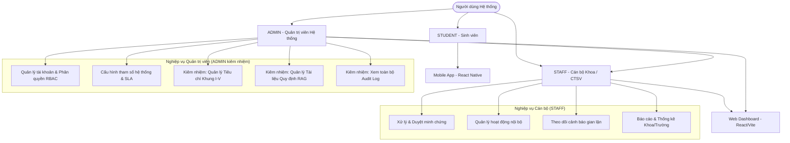
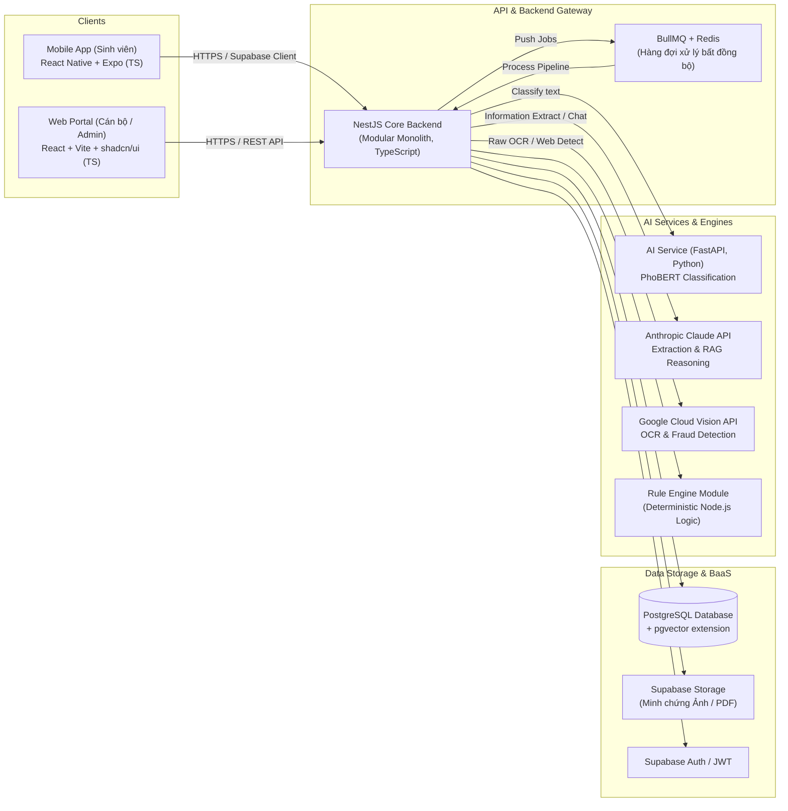
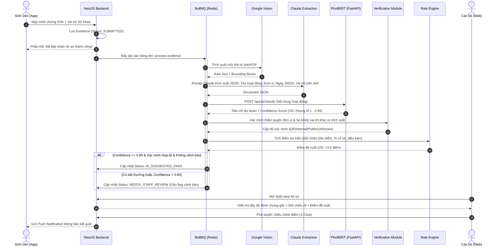
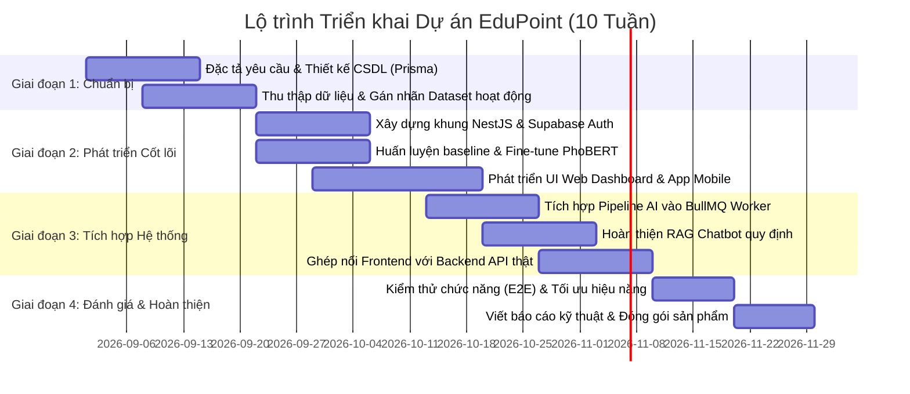

# 🚀 EduPoint — Tài liệu Tổng quan Tính năng, Công nghệ (Techstack) & Thiết kế Giao diện

> **Hệ thống Tự động hóa Đánh giá Điểm Rèn luyện Sinh viên bằng AI kết hợp Rule Engine**
> 
> *Tài liệu đặc tả kiến trúc kỹ thuật, danh mục tính năng, ngăn xếp công nghệ và ngôn ngữ thiết kế toàn diện cho dự án tốt nghiệp / đồ án chuyên ngành PBL6 (Nhóm 3 thành viên).*

---

## 📑 Mục Lục
1. [Giới thiệu & Bối cảnh Dự án](#1-giới-thiệu--bối-cảnh-dự-án)
2. [Mô hình Phân quyền Người dùng (RBAC — 3 vai trò)](#2-mô-hình-phân-quyền-người-dùng-rbac--3-vai-trò)
3. [Danh mục Tính năng Toàn diện (Feature Catalog)](#3-danh-mục-tính-năng-toàn-diện-feature-catalog)
4. [Ngăn xếp Công nghệ (Techstack) & Kiến trúc Hệ thống](#4-ngăn-xếp-công-nghệ-techstack--kiến-trúc-hệ-thống)
5. [Pipeline Xử lý Minh chứng Thông minh (AI + Rule Engine)](#5-pipeline-xử-lý-minh-chứng-thông-minh-ai--rule-engine)
6. [Thiết kế Giao diện & Trải nghiệm Người dùng (UI/UX)](#6-thiết-kế-giao-diện--trải-nghiệm-người-dùng-uiux)
7. [Phân công Nhiệm vụ & Trách nhiệm (Đội ngũ 3 người)](#7-phân-công-nhiệm-vụ--trách-nhiệm-đội-ngũ-3-người)
8. [Lộ trình Triển khai & Tiêu chí Nghiệm thu](#8-lộ-trình-triển-khai--tiêu-chí-nghiệm-thu)

---

## 1. Giới thiệu & Bối cảnh Dự án

### 1.1 Vấn đề Thực tiễn
Đánh giá điểm rèn luyện (ĐRL) sinh viên định kỳ tại các trường đại học hiện nay vẫn tồn tại nhiều hạn chế:
- **Quá tải cho Cán bộ / Cố vấn học tập**: Hàng nghìn sinh viên nộp minh chứng (ảnh giấy chứng nhận, bài viết, xác nhận tham gia hoạt động) vào cuối kỳ, cán bộ phải mở từng ảnh, đối chiếu ngày tháng, đơn vị tổ chức và khung tiêu chí bằng tay.
- **Dễ phát sinh gian lận / trùng lặp**: Ảnh photoshop, sửa thông tin người nhận, dùng lại 1 minh chứng nộp cho nhiều mục điểm, nộp giấy chứng nhận không rõ thẩm quyền.
- **Thiếu nhất quán**: Cùng một hoạt động nhưng cán bộ chấm các mức điểm khác nhau do quy định phức tạp (trần điểm từng mục, khống chế tỷ lệ điểm cổ vũ/tham gia).
- **Sinh viên thiếu thông tin quy chế**: Khó tra cứu hoạt động của mình thuộc tiêu chí nào (Khung I đến Khung V), dẫn đến khiếu nại kéo dài.

### 1.2 Giải pháp EduPoint
EduPoint là hệ sinh thái số hóa thông minh kết hợp:
1. **Ứng dụng Di động (Mobile App)** cho sinh viên: Nộp minh chứng nhanh, nhận kết quả phân tích AI tức thời, theo dõi tiến độ điểm trực quan theo 5 khung và hỏi đáp quy định qua Trợ lý ảo RAG Chatbot.
2. **Cổng Web Quản trị (Web Portal)** cho Cán bộ & Admin: Bàn làm việc thông minh (Smart Dashboard) hỗ trợ duyệt theo mô hình Split-view, phát hiện bất thường tự động, quản trị tiêu chí linh hoạt và trích xuất báo cáo.
3. **Bộ não Xử lý Tự động (AI Core + Rule Engine)**: OCR trích xuất thông tin, mô hình ngôn ngữ tiếng Việt (PhoBERT) phân loại hoạt động, xác minh đa cấp (QR, danh bạ đơn vị nội bộ, email công vụ), và Rule Engine chốt điểm chuẩn xác theo quy chế trường.

---

## 2. Mô hình Phân quyền Người dùng (RBAC — 3 vai trò)

### 2.1 Quyết định Thiết kế cho Đồ án 3 người
> ⚠️ **Design Decision**: Để tối ưu hóa nguồn lực triển khai và phù hợp với quy mô đồ án 3 sinh viên, hệ thống **không tách vai trò riêng "Người phụ trách quy định"** (đánh đổi nguyên tắc *Separation of Duties*). Thay vào đó, **Quản trị viên (Admin) kiêm nhiệm** toàn bộ việc quản lý tiêu chí, tài liệu quy chế làm nguồn RAG và giám sát nhật ký kiểm toán.

Hệ thống phân định rạch ròi 3 vai trò:

### 2.2 Bảng Ma trận Quyền hạn (Role Matrix)

| Nhóm Nghiệp Vụ | Chức Năng Cụ Thể | STUDENT | STAFF | ADMIN | File Spec Quy Chiếu |
|:---|:---|:---:|:---:|:---:|:---|
| **Sinh viên** | Đăng nhập SSO / Tài khoản trường | ✅ | — | — | `FS-S01-dang-nhap.md` |
| | Xem tổng quan điểm & tiến độ 5 khung | ✅ | — | — | `FS-S02-trang-chu-ca-nhan.md` |
| | Wizard 3 bước nộp minh chứng | ✅ | — | — | `FS-S03-nop-minh-chung.md` |
| | Theo dõi trạng thái & Đề xuất AI | ✅ | — | — | `FS-S04-theo-doi-trang-thai.md` |
| | Bổ sung minh chứng theo yêu cầu | ✅ | — | — | `FS-S06-bo-sung-minh-chung.md` |
| | Khiếu nại kết quả đánh giá | ✅ | — | — | `FS-S07-khieu-nai.md` |
| | Chatbot hỏi đáp quy định (RAG) | ✅ | — | — | `FS-S08-chatbot-rag.md` |
| | Lịch sử điểm theo từng học kỳ | ✅ | — | — | `FS-S09-lich-su-diem.md` |
| **Cán bộ** | Dashboard hàng đợi duyệt & SLA | — | ✅ | ✅ | `FS-CB01-dashboard.md` |
| | Split-view duyệt minh chứng & đối chiếu OCR | — | ✅ | ✅ | `FS-CB02-chi-tiet-ho-so.md` |
| | Phê duyệt / Từ chối / Điều chỉnh điểm | — | ✅ | ✅ | `FS-CB03-duyet-minh-chung.md` |
| | Truy vết căn cứ quyết định (AI / Rule) | — | ✅ | ✅ | `FS-CB04-truy-vet-can-cu.md` |
| | Quản lý hoạt động & import DS tham gia | — | ✅ | ✅ | `FS-CB06-quan-ly-hoat-dong.md` |
| | Theo dõi cảnh báo bất thường & gian lận | — | ✅ | ✅ | `FS-CB08-canh-bao-bat-thuong.md` |
| | Xuất báo cáo, bảng điểm Excel | — | ✅ | ✅ | `FS-CB09-bao-cao-thong-ke.md` |
| **Quản trị viên** | **Quản lý Tiêu chí khung I–V & Điểm trần** | — | — | **⚡ ADMIN** | `FS-CB05-quan-ly-tieu-chi.md` |
| *(Admin kiêm)* | **Quản lý Tài liệu Quy định (RAG Source)** | — | — | **⚡ ADMIN** | `FS-CB07-quan-ly-tai-lieu-quy-dinh.md` |
| | **Xem toàn bộ Nhật ký Hệ thống (Audit Log)** | — | — | **⚡ ADMIN** | `FS-CB10-nhat-ky-audit.md` |
| | Quản lý Tài khoản & Phân quyền RBAC | — | — | **⚡ ADMIN** | `FS-A01-quan-ly-tai-khoan-rbac.md` |
| | Cấu hình tham số AI & Ngưỡng duyệt | — | — | **⚡ ADMIN** | `FS-A01-quan-ly-tai-khoan-rbac.md` |
| | Danh mục nền: Khoa, Lớp, Đơn vị nội bộ | — | — | **⚡ ADMIN** | `FS-A01-quan-ly-tai-khoan-rbac.md` |

---

## 3. Danh mục Tính năng Toàn diện (Feature Catalog)

### 3.1 Ứng dụng Di động dành cho Sinh viên (10 Tính năng — `FS-S01` đến `FS-S10`)
1. **FS-S01 — Xác thực & Đăng nhập**: Hỗ trợ đăng nhập tài khoản sinh viên (MSSV/Email trường), tích hợp Supabase Auth, ghi nhớ phiên an toàn.
2. **FS-S02 — Trang chủ & Tiến độ 5 Khung**: Dashboard trực quan hiển thị tổng điểm rèn luyện tạm tính kỳ hiện tại, xếp loại (Xuất sắc/Tốt/Khá/TB/Yếu), biểu đồ thanh tiến độ từng khung I, II, III, IV, V kèm mức điểm tối đa (Cap).
3. **FS-S03 — Nộp Minh chứng (Wizard 3 bước)**:
   - *Bước 1*: Chọn hoạt động (từ danh sách đã đăng ký hoặc nhập hoạt động bên ngoài).
   - *Bước 2*: Chọn loại minh chứng (Ảnh GCN, Link bài viết, File PDF xác nhận, Ảnh chụp minh chứng) và tải file lên (tối đa 10MB/file, nén tự động trên thiết bị).
   - *Bước 3*: Xác nhận vai trò tham gia (Ban tổ chức / Tình nguyện viên / Người tham gia / Cổ vũ) và gửi nộp.
4. **FS-S04 — Theo dõi Trạng thái Hồ sơ**: Danh sách các minh chứng đã nộp với huy hiệu trạng thái rõ ràng (Chờ xử lý, Đang phân tích AI, Cần bổ sung, Đã duyệt, Từ chối).
5. **FS-S05 — Chi tiết Đề xuất AI**: Xem chi tiết kết quả phân tích sơ bộ từ AI: tiêu chí gợi ý, số điểm dự kiến, độ tin cậy (Confidence score) và lý do giải thích minh bạch.
6. **FS-S06 — Bổ sung Minh chứng**: Cho phép tải thêm minh chứng hoặc cập nhật ảnh rõ nét hơn khi cán bộ gửi yêu cầu bổ sung kèm lý do.
7. **FS-S07 — Khiếu nại Kết quả**: Sinh viên có quyền tạo khiếu nại (tối đa 2 lần/minh chứng) kèm giải trình khi không đồng ý với kết quả chấm hoặc bị trừ điểm.
8. **FS-S08 — Trợ lý ảo Quy chế (RAG Chatbot)**: Chatbot thông minh tra cứu quy chế đánh giá điểm rèn luyện của trường, trả lời chính xác điều khoản, trích dẫn số trang/văn bản cụ thể.
9. **FS-S09 — Lịch sử & Bảng điểm các Kỳ**: Tra cứu điểm rèn luyện chính thức của các học kỳ trước, bảng phân rã điểm theo từng hoạt động, tải bảng điểm tổng kết (PDF).
10. **FS-S10 — Trung tâm Thông báo**: Nhận thông báo đẩy (Push notification) ngay khi minh chứng được duyệt, bị từ chối, có yêu cầu bổ sung hoặc mở đợt chấm điểm mới.

### 3.2 Cổng Web dành cho Cán bộ (STAFF)
1. **FS-CB01 — Smart Dashboard**: Thống kê số lượng hồ sơ tồn đọng, hồ sơ sắp chạm ngưỡng SLA (48h), tỷ lệ duyệt tự động thành công, danh sách hồ sơ ưu tiên cần xử lý.
2. **FS-CB02 — Chi tiết Hồ sơ (Split-view Review)**: Giao diện màn hình kép:
   - *Cột trái*: Trình xem ảnh/file minh chứng chất lượng cao (hỗ trợ phóng to, xoay ảnh, lật trang PDF).
   - *Cột phải*: Toàn bộ thông tin đối chiếu gồm dữ liệu OCR, kết quả phân loại PhoBERT, kết quả xác minh đơn vị tổ chức, đề xuất điểm của Rule Engine và cảnh báo gian lận (nếu có).
3. **FS-CB03 — Duyệt Minh chứng Đa tác vụ**: Nút hành động 1-click (Phê duyệt đề xuất AI, Chỉnh sửa mức điểm/tiêu chí, Yêu cầu bổ sung, Từ chối kèm lý do mẫu).
4. **FS-CB04 — Truy vết Căn cứ Quyết định**: Hiển thị bảng điều tra nguồn gốc: Minh chứng này được cộng bao nhiêu điểm, căn cứ theo điều khoản nào, do AI đề xuất hay Cán bộ chỉnh sửa, lịch sử thay đổi qua từng mốc thời gian.
5. **FS-CB06 — Quản lý Hoạt động & Danh sách Tham gia**: Tạo hoạt động nội bộ trường/khoa, import danh sách sinh viên tham gia bằng Excel. Khi sinh viên nộp minh chứng thuộc hoạt động này, hệ thống tự động đối chiếu khớp ngay lập tức.
6. **FS-CB08 — Trung tâm Cảnh báo Bất thường**: Bộ lọc phát hiện các hành vi rủi ro:
   - Trùng lặp mã hash ảnh / URL ảnh trên hệ thống (nộp cùng 1 ảnh cho 2 người hoặc 2 mục).
   - Ảnh bị can thiệp chỉnh sửa số/tên (phát hiện qua ELA / metadata / bất thường phông chữ).
   - Ngày cấp giấy chứng nhận nằm ngoài khoảng thời gian học kỳ đánh giá.
7. **FS-CB09 — Báo cáo & Thống kê**: Biểu đồ phân bố điểm theo Khoa/Khóa/Lớp, tỷ lệ xếp loại, xuất danh sách điểm rèn luyện chính thức ra định dạng Excel chuẩn của Phòng Đào tạo & CTSV.

### 3.3 Cổng Web dành cho Quản trị viên (ADMIN — Kiêm nhiệm)
1. **FS-A01 — Quản lý Tài khoản & Phân quyền RBAC**: Quản lý danh sách tài khoản (Student, Staff, Admin), khóa/mở khóa, reset mật khẩu, phân công quyền hạn.
2. **FS-A01 — Cấu hình Tham số Hệ thống**: Điều chỉnh ngưỡng tin cậy AI (Confidence threshold, mặc định 0.70), thời hạn SLA xử lý (48 giờ), giới hạn dung lượng tải lên, hạn ngạch tra cứu chatbot RAG.
3. **FS-A01 — Quản lý Danh mục Dữ liệu Nền**: CRUD danh mục Khoa, Ngành, Khóa, Lớp học và **Danh mục Đơn vị Tổ chức Nội bộ** (Đoàn Thanh niên, Hội Sinh viên, các CLB Đội Nhóm chính quy) phục vụ module xác minh thẩm quyền.
4. **FS-CB05 — Quản lý Tiêu chí & Điểm trần (ADMIN only)**: Cấu hình bảng tiêu chí Khung I đến Khung V, điểm quy định cho từng vai trò (BTC, TTV, Thành viên, Cổ vũ), mức điểm trần từng mục (Cap). Hỗ trợ lưu trữ lịch sử phiên bản tiêu chí (Versioning).
5. **FS-CB07 — Quản lý Tài liệu Quy định RAG (ADMIN only)**: Tải lên các văn bản quy định, quy chế điểm rèn luyện chính thức (PDF/DOCX), kích hoạt pipeline băm nhỏ (chunking), tạo vector embedding và lưu vào cơ sở dữ liệu `pgvector`. Đánh dấu tài liệu hết hiệu lực khi có quy chế mới thay thế.
6. **FS-CB10 — Nhật ký Hệ thống Toàn diện / Audit Log (ADMIN only)**: Ghi nhận và hiển thị bất biến toàn bộ hành vi trong hệ thống (Ai làm gì, thời điểm nào, IP nào, giá trị cũ/mới là gì), phục vụ giải trình và kiểm toán dữ liệu.

---

## 4. Ngăn xếp Công nghệ (Techstack) & Kiến trúc Hệ thống

### 4.1 Bảng Tổng hợp Công nghệ Lựa chọn

| Tầng Kiến Trúc | Công Nghệ Lựa Chọn | Phiên Bản | Lý Do Lựa Chọn & Đánh Đổi Kỹ Thuật |
|:---|:---|:---:|:---|
| **Mobile App (Sinh viên)** | **React Native + Expo SDK** | Expo SDK 51+ | Phát triển nhanh đa nền tảng (iOS & Android) từ một codebase TypeScript duy nhất. Hệ sinh thái Expo phong phú (Expo Camera, ImagePicker, FileSystem, PushNotifications). |
| | **Expo Router** | v3+ | Điều hướng dạng File-based trực quan, dễ quản lý stack nộp minh chứng và tab bar. |
| | **TanStack Query (React Query)** | v5 | Quản lý server state, cache dữ liệu điểm, tự động refetch khi có thông báo mới. |
| **Web Portal (Cán bộ & Admin)** | **React + Vite** | React 18, Vite 5 | Tốc độ build siêu nhanh, hiệu năng cao hơn CRA. |
| | **TypeScript** | 5.x | Đảm bảo kiểu dữ liệu an toàn xuyên suốt từ Database (Prisma) lên UI. |
| | **Tailwind CSS + shadcn/ui** | Latest | Thư viện UI hiện đại, chuẩn thẩm mỹ, sở hữu toàn bộ code component, hỗ trợ dark mode và tùy biến cao cho giao diện Split-view. |
| | **TanStack Table** | v8 | Hỗ trợ phân trang, lọc nhiều điều kiện, sắp xếp bảng hồ sơ hàng nghìn dòng mượt mà. |
| **Core Backend** | **NestJS** | v10+ | Kiến trúc Enterprise chặt chẽ (Module, Controller, Service, Guard, Interceptor), Dependency Injection mạnh mẽ, cực kỳ phù hợp cho team làm việc song song. |
| | **Prisma ORM** | v5+ | Type-safe ORM tốt nhất cho Node.js, sinh type tự động dùng chung cho frontend (`shared-types`), migration an toàn. |
| | **BullMQ + Redis** | BullMQ 5+ | Hàng đợi tác vụ bất đồng bộ (Queue). Khi sinh viên nộp bài, request trả về ngay mã tiếp nhận, toàn bộ pipeline OCR & AI chạy nền không gây treo app. |
| **Cơ Sở Dữ Liệu & BaaS** | **PostgreSQL (Supabase)** | v15+ | Hệ quản trị CSDL quan hệ chuẩn mực, hỗ trợ ACID, bảo toàn tính toàn vẹn dữ liệu điểm. |
| | **pgvector** | Extension | Lưu trữ vector embeddings của tài liệu quy định ngay trong PostgreSQL, không cần tốn thêm chi phí và độ phức tạp cho Pinecone/Milvus riêng biệt. |
| | **Supabase Storage** | S3-compatible | Lưu trữ file ảnh/PDF minh chứng với đường dẫn bảo mật (Signed URLs) và bucket permissions. |
| **AI Microservice (Inference)** | **Python + FastAPI** | Python 3.10+ | Chuẩn công nghiệp cho phục vụ mô hình ML, hiệu năng cao với async, tự động sinh tài liệu OpenAPI / Swagger. |
| | **PyTorch + Hugging Face Transformers** | Latest | Nền tảng huấn luyện và suy luận mô hình `vinai/phobert-base-v2` cho bài toán phân loại hoạt động tiếng Việt. |
| **LLM & External APIs** | **Anthropic Claude 3.5 Sonnet / Haiku** | API | Khả năng đọc hiểu tiếng Việt xuất sắc, trích xuất thực thể có cấu trúc JSON cực kỳ ổn định, suy luận chính xác cho RAG chatbot. |
| | **Google Cloud Vision API** | REST API | Engine OCR số một cho tài liệu tiếng Việt có dấu, phông chữ bằng khen phức tạp, hỗ trợ Web Detection để phát hiện ảnh copy từ mạng Internet. |
| **DevOps & Triển khai** | **Docker & Docker Compose** | Latest | Đóng gói môi trường chạy backend, redis và ai-service nhất quán giữa local và production. |
| | **Vercel** | Free Tier | Deploy Web Portal nhanh chóng với CI/CD tự động từ GitHub branch. |
| | **Render / Railway** | Cloud PaaS | Host NestJS Backend và FastAPI AI service ổn định. |

---

## 5. Pipeline Xử lý Minh chứng Thông minh (AI + Rule Engine)

Khi sinh viên tải lên một minh chứng, hệ thống không duyệt tự động 100% một cách rủi ro, mà vận hành qua quy trình **6 bước kết hợp Human-in-the-loop**:

---

## 6. Thiết kế Giao diện & Trải nghiệm Người dùng (UI/UX)

### 6.1 Bảng Màu Nhận Diện Thương Hiệu (Design System)
- **Primary Color (Chủ đạo)**: Deep Navy Blue (`#1E3A8A` / `rgb(30, 58, 138)`) — Tạo cảm giác học thuật, uy tín và nghiêm túc.
- **Accent Color (Điểm nhấn)**: Electric Indigo / Cyan (`#0284C7` / `#38BDF8`) — Thể hiện yếu tố công nghệ thông minh và hiện đại.
- **Semantic Status Colors**:
  - 🟢 **Thành công / Hợp lệ (Success)**: Emerald Green (`#059669` / Badge: `bg-emerald-50 text-emerald-700 border-emerald-200`)
  - 🟡 **Chờ duyệt / Cần lưu ý (Warning)**: Amber Yellow (`#D97706` / Badge: `bg-amber-50 text-amber-700 border-amber-200`)
  - 🔴 **Từ chối / Cảnh báo gian lận (Danger)**: Rose Red (`#E11D48` / Badge: `bg-rose-50 text-rose-700 border-rose-200`)
  - 🟣 **Gợi ý từ AI (AI Suggestion)**: Violet Purple (`#7C3AED` / Badge: `bg-purple-50 text-purple-700 border-purple-200`)
  - ⚪ **Trung tính (Neutral)**: Slate Gray (`#64748B` / Border: `#E2E8F0` / Background: `#F8FAFC`)

### 6.2 Bố cục Giao diện Split-view Đặc trưng trên Web Cán bộ
Màn hình duyệt hồ sơ được thiết kế theo tỷ lệ vàng **50% : 50%**:
- **Bên trái (Document Inspection View)**:
  - Khung xem tài liệu độ phân giải cao, hỗ trợ zoom số đến 300%, xoay ảnh 90°, lật trang PDF và xem mã nguồn gốc.
  - Lớp phủ Bounding Boxes đánh dấu vị trí AI tìm thấy tên sinh viên và con dấu/chữ ký.
- **Bên phải (Verification & Decision Panel)**:
  - Thẻ tóm tắt thông tin sinh viên (Họ tên, MSSV, Lớp, Khoa).
  - Kết quả bóc tách thông tin từ OCR (so khớp với thông tin sinh viên đã khai).
  - Hộp gợi ý AI: Hiển thị tiêu chí đề xuất, mức độ tin cậy kèm thanh tiến trình trực quan.
  - Form điều chỉnh nhanh: Cho phép cán bộ thay đổi tiêu chí, tăng giảm điểm theo lý do cụ thể trước khi ấn nút **[Duyệt]** hoặc **[Từ chối]**.

---

## 7. Phân công Nhiệm vụ & Trách nhiệm (Đội ngũ 3 người)

| Thành Viên | Phụ Trách Chính | Công Nghệ Sử Dụng | Sản Phẩm Bàn Giao Cụ Thể |
|:---|:---|:---|:---|
| **NGƯỜI A** *(Backend & Data Engineer)* | **Core Backend + Database + Rule Engine** | - NestJS, TypeScript - Prisma ORM, PostgreSQL - Supabase (Auth, Storage) - BullMQ, Redis - Docker | 1. Toàn bộ REST API Backend và WebSocket thông báo. 2. CSDL hoàn chỉnh, migrations và seed dữ liệu chuẩn. 3. Rule Engine tính điểm theo đúng quy định trường. 4. Hàng đợi BullMQ điều phối pipeline nền. 5. Phân quyền RBAC (3 vai trò) và hệ thống Audit Log. |
| **NGƯỜI B** *(Frontend & Mobile Developer)* | **Web Portal + Mobile App + UI/UX System** | - React, Vite, shadcn/ui - React Native, Expo SDK - TanStack Query/Table - Tailwind CSS | 1. Ứng dụng Mobile hoàn chỉnh cho Sinh viên (10 màn hình chuẩn UX). 2. Cổng Web cho Cán bộ & Admin với màn hình Split-view cao cấp. 3. Thư viện giao diện dùng chung và tích hợp API mượt mà. 4. Mock data cho giai đoạn phát triển độc lập. 5. Cấu hình Push Notifications qua Expo. |
| **NGƯỜI C** *(AI/ML & RAG Engineer)* | **AI Pipeline + Fine-tune PhoBERT + RAG Engine** | - Python, PyTorch - Hugging Face, PhoBERT - FastAPI, Uvicorn - Claude API, Google Vision - pgvector, LangChain | 1. Dataset gán nhãn hoạt động tiếng Việt chuẩn hóa. 2. Mô hình PhoBERT fine-tuned kèm báo cáo đánh giá (Accuracy, Macro-F1). 3. Microservice FastAPI phục vụ suy luận mô hình. 4. Pipeline trích xuất JSON bằng Claude Prompt Engineering. 5. Chatbot RAG tra cứu quy chế kèm trích dẫn văn bản chính xác. |

---

## 8. Lộ trình Triển khai & Tiêu chí Nghiệm thu

### Tiêu chí Nghiệm thu Hệ thống (Acceptance Goals):
1. **Độ chính xác Phân loại (PhoBERT)**: Đạt Macro-F1 $\ge 0.85$ trên tập dữ liệu kiểm thử độc lập (Test set) các hoạt động sinh viên.
2. **Hiệu năng Pipeline**: Thời gian xử lý từ lúc sinh viên nộp minh chứng đến khi AI trả về kết quả gợi ý không quá **15 giây** (xử lý bất đồng bộ, không nghẽn luồng người dùng).
3. **Độ ổn định của RAG Chatbot**: 100% câu trả lời có trích dẫn đúng số hiệu văn bản/trang quy định của trường; từ chối trả lời nếu thông tin nằm ngoài phạm vi tài liệu đã nạp.
4. **Trải nghiệm duyệt của Cán bộ**: Giảm ít nhất **70% thời gian** duyệt mỗi minh chứng so với quy trình thủ công truyền thống nhờ cơ chế gợi ý và màn hình Split-view đối chiếu tức thời.

---

> 📌 **Tài liệu tham chiếu liên quan**:
> - Bảng đặc tả chi tiết 22 tính năng: [docs/05-feature-specs/README.md](../05-feature-specs/README.md)
> - Lược đồ cơ sở dữ liệu: [docs/02-database/schema.prisma](../02-database/schema.prisma)
> - Cấu trúc thư mục dự án tổng thể: [cautruc.md](../../cautruc.md)
