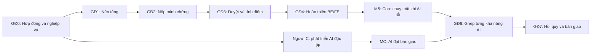

# Kế hoạch triển khai EduPoint — BE/FE trước, AI tích hợp sau

Ngày lập: **22/09/2026**. Trạng thái: **kế hoạch triển khai, chưa phải danh sách chức năng đã hoàn thành**.

## 1. Mục tiêu và thứ tự ưu tiên

Hoàn thành một hệ thống **Backend + Web cán bộ/admin + Mobile sinh viên chạy với dữ liệu thật**, hỗ trợ nộp minh chứng, xét duyệt thủ công, Rule Engine, bổ sung, khiếu nại, bảng điểm và quản trị trước khi ghép AI. Người C phát triển AI độc lập; chỉ ghép khi cả bản BE/FE và gói AI tương ứng đạt điều kiện bàn giao.

**“FE” trong kế hoạch bao gồm cả `apps/web` và `apps/mobile`**, theo cấu trúc đang có. Không thêm một ứng dụng web sinh viên riêng trong phạm vi nền tảng.

| Người | Trách nhiệm chính | Thư mục sở hữu |
|---|---|---|
| A | BE, database, auth, storage, Rule Engine, worker, API, vận hành | `apps/backend`, migration, hợp đồng API |
| B | FE Web + Mobile, UX, API client, kiểm thử luồng người dùng | `apps/web`, `apps/mobile` |
| C | Dataset, OCR/extraction, PhoBERT, AI service, RAG, đánh giá AI | `packages/ai-core`, `apps/ai-service`, `research` |

A sở hữu việc ghi dữ liệu nghiệp vụ, quyết định điểm và điều phối queue. C trả kết quả phân tích; B hiển thị theo quyền. Rule Engine là nghiệp vụ BE của A và **không chờ AI**.

## 2. Đọc tài liệu theo thứ tự

1. [Hiện trạng, mâu thuẫn và quyết định lập kế hoạch](00-hien-trang-va-quyet-dinh.md).
2. [Kế hoạch riêng người A — Backend](01-ke-hoach-backend.md).
3. [Kế hoạch riêng người B — Frontend Web + Mobile](02-ke-hoach-frontend.md).
4. [Task riêng người C — AI/ML/RAG](04-task-rieng-nguoi-c-ai.md).
5. [GĐ6–GĐ7: hợp đồng ghép AI và phát hành](05-tich-hop-ai-va-nghiem-thu.md).
6. [Ma trận 37 trang và phạm vi hoãn](06-ma-tran-pham-vi.md).

Nguồn đặc tả: [API BE](../../EduPoint_API_BE.md), [thiết kế FE](../../EduPoint_ThietKe_Trang_FE.md), [feature specs](../05-feature-specs/README.md), [kiến trúc](../../cautruc.md). Các xung đột đã biết được xử lý theo tài liệu 00, không coi những nguồn này đã đồng bộ sẵn.

## 3. Các giai đoạn và mốc nghiệm thu

| GĐ | Kết quả cần đạt | Người | Phụ thuộc / điều kiện kết thúc |
|---|---|---|---|
| 0 | Chốt stack, enum, contract, chính sách nghiệp vụ và danh mục chênh lệch schema | A+B; C góp phần contract AI | M0: schema/contract mẫu đủ cho A/B/C làm độc lập |
| 1 | Monorepo chạy được; login 3 role; DB/Storage; FE shell và mock | A+B | M1: tài khoản thật đăng nhập đúng role, sai scope bị chặn |
| 2 | Admin tạo danh mục; Officer tạo hoạt động/điểm danh; Student nộp hồ sơ thật | A+B | M2: không bật AI vẫn nhận và đưa hồ sơ vào hàng đợi |
| 3 | Duyệt thủ công + Rule Engine + bổ sung + khiếu nại + bảng điểm | A+B | M3: chu trình nghiệp vụ đầy đủ, điểm không trùng/vượt trần |
| 4 | Báo cáo, quản trị, audit, vận hành, hoàn thiện Web/Mobile | A+B | M4: các trang thuộc bản Core có dữ liệu thật, không dựa mock |
| 5 | E2E, phân quyền, tính toàn vẹn điểm, build và staging Core | A+B | **M5: BE/FE Core được nghiệm thu khi AI tắt hoàn toàn** |
| C0–C4 | AI nghiên cứu và đóng gói độc lập | C | **MC: gói AI đủ contract, chất lượng và tài liệu bàn giao** |
| 6 | Ghép từng khả năng AI vào Core đã ổn định | A+B+C | Chỉ bắt đầu khi M5 và MC của khả năng đó đạt |
| 7 | Nghiệm thu bản tích hợp, báo cáo, demo và phát hành | A+B+C | M7: hồi quy Core đạt khi AI bật, lỗi hoặc bị tắt |

Không chờ đến GĐ6 mới nối FE với BE: B dùng mock để dựng UI, rồi thay bằng API thật ngay khi từng nhóm API của A sẵn sàng, từ GĐ1 đến GĐ4.

## 4. Cách quản lý task

- Mỗi dòng task có ID, người chịu trách nhiệm, phụ thuộc, đầu ra và điều kiện hoàn thành. Khi tạo issue, dùng nguyên ID làm tiền tố tiêu đề. A làm theo file Backend, B làm theo file Frontend, C làm theo file AI; ba file gộp cũ chỉ dùng để truy vết.
- `[ ]` = chưa làm; `[x]` = đã nghiệm thu. Tất cả task triển khai khởi tạo là chưa làm. Việc đã có file trong repo không đồng nghĩa task đã xong.
- `BE`, `FE`, `AI`, `INT`, `QA`, `PL` lần lượt là Backend, Frontend, AI, tích hợp, kiểm thử và chốt thiết kế.
- Phụ thuộc là ID task. “M2”, “M3”, “M4”, “M5” là mốc nghiệm thu ở bảng trên. Trong cùng giai đoạn, làm theo dependency, không bắt buộc theo thứ tự dòng.
- `XS/S/M/L` là ước lượng tương đối: dưới nửa ngày / 0,5–1 ngày / 1–2 ngày / 2–3 ngày công tập trung. Task vượt 3 ngày phải tách issue con; chưa có deadline hay số giờ làm mỗi tuần nên **không cam kết lịch ngày cố định**.
- Ưu tiên P0: đường chạy Core; P1: hoàn thiện bản Core trước M5; P2: ghép AI; P3: nâng cao sau bản tích hợp. Ngày lịch chỉ lập sau khi A/B/C báo năng lực thực tế.
- B phụ trách hai ứng dụng: ưu tiên màn hình nộp của Mobile và màn hình duyệt của Web trước dashboard đẹp, biểu đồ và tác vụ nâng cao.

## 5. Definition of Done dùng chung

Task BE xong khi contract, validation, phân quyền/scope, audit nếu có mutation quan trọng, migration cần thiết và test nghiệp vụ tương ứng đã đạt. Task FE xong khi dùng API thật, có loading/empty/error/forbidden, xử lý hết phiên và không hiển thị điểm chờ thành điểm chính thức. Mock chỉ dùng phát triển/kiểm thử, không tính là hoàn thành tích hợp.

Mỗi task có PR hoặc commit, bằng chứng kiểm thử và ghi rõ giới hạn còn lại. Người làm tự kiểm tra trước; người còn lại A/B review luồng liên quan; C review kết quả AI. Không mở rộng phạm vi P3 làm chậm M5. Chỉ đánh dấu mốc xong khi các tiêu chí nghiệm thu của mốc đều đạt.

## 6. Bắt đầu từ đâu

**A:** theo [plan Backend](01-ke-hoach-backend.md), bắt đầu `PL-01 → PL-02/PL-03 → PL-05 → BE-01/02`. **B:** theo [plan Frontend](02-ke-hoach-frontend.md), bắt đầu `PL-04 → PL-06/PL-07 → FE-01/02/04`. **C:** theo [plan AI](04-task-rieng-nguoi-c-ai.md), bắt đầu `AI-01 → AI-02/AI-03`; chưa ghép model vào luồng nộp hồ sơ thật.

Ưu tiên demo đầu tiên: **Admin tạo kỳ/tiêu chí → Officer tạo hoạt động → Student nộp ảnh → Officer duyệt bằng Rule Engine → Student thấy điểm và lịch sử**. Sau đó hoàn thiện bổ sung, khiếu nại, báo cáo và các ca lỗi.
