# Hướng dẫn Kiến trúc AI, Huấn luyện Mô hình từ A đến Z và Hoàn thiện Task AI

| Thuộc tính | Giá trị |
|---|---|
| Phiên bản | 2.1 — đối chiếu mã nguồn và lần train thực tế ngày 2026-11-23 (theo [DEC-014](DECISIONS.md)) |
| Phạm vi | `apps/ai-service`, `apps/backend/src/evidence`, `research/activity-classification`, `research/image-classification` |
| Liên kết đặc tả | [F06](features/06-evidence-and-storage.md), [F07](features/07-evidence-review-and-verification.md), [F14](features/14-audit-monitoring-and-ai-jobs.md) |

> [!IMPORTANT]
> AI chạy chế độ **hỗ trợ (`AI_MODE=ASSIST`)**: chỉ đề xuất `suggestedScore`, `confidence`, `decisionTier` và lý do. AI **không** chốt `officialScore`; cán bộ luôn là người quyết định cuối.

---

## 1. Kiến trúc tổng thể

```mermaid
flowchart LR
    A["Sinh viên tải minh chứng"] --> B["Backend tạo Evidence + AiProcessingJob"]
    B --> C["EvidenceProcessingWorker (poll 3s, lease, timeout)"]
    C --> D["FastAPI POST /evidence/process"]
    D --> L1["Tầng 1: Chất lượng ảnh & Forensics"]
    L1 --> L2["Tầng 2: Khuôn mặt & Bối cảnh (MobileNetV3)"]
    L2 --> L3["Tầng 3: OCR tiếng Việt"]
    L3 --> L4["Tầng 4: Phân loại tiêu chí (Rubric Classifier)"]
    L4 --> L5["Tầng 5: Đối chiếu định danh, học kỳ, tiêu chí"]
    L5 --> L6["Tầng 6: Phôi chuẩn & Xác minh web"]
    L6 --> E["Worker hợp nhất, lưu AiSuggestion"]
    E --> F["Cán bộ duyệt / Sinh viên xem kết quả"]
```



| Tầng | Module (đã đối chiếu) | Nhiệm vụ | Có mô hình học máy? |
|---|---|---|---|
| 1 | [quality_forensics.py](../apps/ai-service/src/quality_forensics.py) | Độ mờ, độ phân giải, ELA, pHash trùng, chụp màn hình, `detect_synthetic_graphic` (ảnh đồ họa dựng phẳng) | Không — luật/thống kê ảnh |
| 2 | [face_verifier.py](../apps/ai-service/src/face_verifier.py) | Phát hiện khuôn mặt; phân loại bối cảnh 7 lớp bằng `event_scene_classifier.pt` | **Có — Pipeline B** |
| 3 | [vietnamese_ocr_engine.py](../apps/ai-service/src/vietnamese_ocr_engine.py), [ocr_extractor.py](../apps/ai-service/src/ocr_extractor.py) | OCR (`rapidocr_vietocr`, dự phòng Tesseract `vie+eng`), trích họ tên/MSSV/lớp/ngày/đơn vị | Dùng mô hình OCR có sẵn, không train trong repo |
| 4 | [predictor.py](../apps/ai-service/src/predictor.py) | Dự đoán mục tiêu chí từ OCR + tên hoạt động | **Có — Pipeline A** |
| 5 | [criterion_evaluator.py](../apps/ai-service/src/criterion_evaluator.py) | Đối chiếu định danh, ngày cấp trong kỳ, tiêu chí kê khai, ra điểm gợi ý | Không — luật nghiệp vụ |
| 6 | [template_matcher.py](../apps/ai-service/src/template_matcher.py), [web_search_verifier.py](../apps/ai-service/src/web_search_verifier.py) | So pHash + tỷ lệ khung với kho phôi; tìm nguồn web và xếp hạng `official/news/social/public` | Không — **Pipeline C** chỉ đăng ký dữ liệu tham chiếu |

Điều phối: [pipeline_orchestrator.py](../apps/ai-service/src/pipeline_orchestrator.py), [main.py](../apps/ai-service/src/main.py); phía backend: [evidence-processing.worker.ts](../apps/backend/src/evidence/evidence-processing.worker.ts).

---

## 2. Chống giả mạo và phân tầng quyết định

| Chốt chặn | Nơi xử lý | Hệ quả |
|---|---|---|
| Ảnh đồ họa dựng phẳng: thẻ `Software` (Canva, Photoshop, Illustrator, Figma, Paint, GIMP), tỷ lệ khối 8×8 phẳng cao, dấu đỏ vector đồng màu | `detect_synthetic_graphic` | `syntheticGraphicMismatch` → `RED`, điểm 0 |
| Ảnh trùng (pHash) | Tầng 1 | `isDuplicate` → `documentMismatch` |
| Sai MSSV / họ tên | Tầng 5 | `RED`, điểm 0, `INVALID` |
| Sai học kỳ (ngày cấp ngoài `startDate..endDate`) | Tầng 5 | Không khớp kỳ |
| Model phân loại `KHONG_HOP_LE` với confidence ≥ 0,65 | `criterion_evaluator.py` | `NOT_MATCHED`, điểm 0 |
| Nguồn web chỉ là mạng xã hội | worker | Không tự bật `activityExistsVerified`; chỉ bật khi `confidenceBoost >= 20` (nguồn `official`) |

Tên miền chính thống cấu hình qua `OFFICIAL_SOURCE_DOMAINS`, `DUT_DOMAIN`, `NEWS_SOURCE_DOMAINS`, `SOCIAL_SOURCE_DOMAINS` trong [config.py](../apps/ai-service/src/config.py).

| Tier | Ý nghĩa | Điểm gợi ý |
|---|---|---|
| `GREEN` | Khớp đủ, có xác nhận mạnh | Tối đa tiêu chí |
| `YELLOW_STRONG` | Khớp định danh/kỳ/tiêu chí, cần cán bộ xác nhận | Tối đa tiêu chí, `NEEDS_HUMAN_REVIEW` |
| `YELLOW_REVIEW` | Thiếu dữ kiện / OCR yếu | Thận trọng hoặc 0 |
| `RED` | Giả mạo, trùng, sai người, sai kỳ, không hợp lệ | **0** |

---

## 3. Huấn luyện mô hình từ A đến Z

### 3.0. Môi trường

Đã kiểm trên máy dev: Python 3.11.9, scikit-learn 1.8.0, torch 2.11.0+cpu, torchvision 0.26.0+cpu. Gói `onnx` chưa cài nên mô hình ảnh xuất **TorchScript `.pt`**.

```powershell
pip install -r apps/ai-service/requirements.txt
pip install -r research/activity-classification/requirements.txt
pip install torch torchvision
```

Trên PowerShell nên đặt `$env:PYTHONIOENCODING="utf-8"` để in tiếng Việt không lỗi.

---

### 3.1. Pipeline A — Rubric Classifier (phân loại mục tiêu chí từ văn bản)

**11 nhãn** (nghĩa theo `CRITERION_HUMAN_NAMES` trong [predictor.py](../apps/ai-service/src/predictor.py); số `MUC_x` là số mục trong rubric ngoại khóa DUT, ánh xạ sang `criterionCode` cùng số):

| Nhãn | Nội dung | Nhãn | Nội dung |
|---|---|---|---|
| `MUC_4` | CLB học thuật / NCKH / Khởi nghiệp | `MUC_12` | Phục vụ cộng đồng / Tình nguyện / Hiến máu |
| `MUC_5` | NCKH / Olympic / Cuộc thi học thuật | `MUC_13` | Ban tổ chức / Cộng tác viên |
| `MUC_8` | Giáo dục chính trị / Kỹ năng mềm / Nội quy | `MUC_14` | Cán bộ lớp/Đoàn/Hội hoàn thành tốt nhiệm vụ |
| `MUC_9` | Văn hóa / Văn nghệ / Thể thao | `MUC_15` | Cán bộ xuất sắc được khen thưởng |
| `MUC_10` | Tuyên truyền / Phòng chống TNXH | `MUC_16` | Cán bộ đoàn thể khen thưởng cấp Trường trở lên |
| `KHONG_HOP_LE` | Không thuộc tiêu chí tính điểm | | |

Thư mục làm việc: `research/activity-classification`.

| Bước | Lệnh | Làm gì | Đầu ra |
|---|---|---|---|
| A1 | `python prepare_dataset.py` | Đọc `docs/dataset-final-20261102/data_tracker.xlsx` + corpus quy chế + mẫu tuyển chọn; gán `group_id`; chia train/val/test không rò rỉ nhóm | `datasets/labeled_all.csv`, `train.csv`, `val.csv`, `test.csv`, `unlabeled_pool.csv`, `dataset_summary.json` |
| A2 | `python train_baseline.py` | CV 5-fold `StratifiedGroupKFold` so sánh `tfidf_logreg`, `tfidf_linear_svc` (Calibrated), `tfidf_complement_nb`; đặc trưng TF-IDF word 1–3 + char_wb 3–5; chọn theo Macro-F1; fit lại trên toàn bộ dữ liệu có nhãn | `apps/ai-service/model/rubric_classifier.joblib`, `rubric_classifier_meta.json`, `datasets/pseudo_labeled_suggestions.csv` |
| A3 | `python evaluate.py` | Fit mô hình thắng CV **chỉ trên train+val**, đánh giá mù trên test, so với keyword baseline, kèm Wilson 95% CI | `evaluation_report.json` |
| A3b | `python error_analysis.py` | Liệt kê mẫu test bị nhầm + top-3 xác suất (cũng fit trên train+val để không rò rỉ) | `error_analysis_report.json` |
| A4 | `python export_model.py` | Nạp lại artifact production, kiểm số lớp/version | In JSON xác nhận |

Chạy liền một lượt:

```powershell
cd research/activity-classification
$env:PYTHONIOENCODING="utf-8"
python prepare_dataset.py; python train_baseline.py; python evaluate.py; python error_analysis.py; python export_model.py
```

**Mở rộng dữ liệu:** thêm dòng vào `data_tracker.xlsx` (nguồn người gán nhãn) hoặc vào danh sách mẫu trong [prepare_dataset.py](../research/activity-classification/prepare_dataset.py). Dùng `pseudo_labeled_suggestions.csv` làm gợi ý: dòng `HIGH_CONF_CHECK` vẫn phải người duyệt trước khi đưa vào tập có nhãn. Mỗi lớp nên có ≥ 30 mẫu thật, nhiều `group_id` khác nhau.

---

### 3.2. Pipeline B — MobileNetV3-Small phân loại bối cảnh ảnh

**7 lớp:** `GIAY_KHEN_GCN`, `GIAY_HIEN_MAU`, `SU_KIEN_HOI_TRUONG`, `SU_KIEN_TINH_NGUYEN`, `SU_KIEN_VAN_NGHE_THE_THAO`, `SU_KIEN_CLB_NGAY_HOI`, `KHONG_PHAI_MINH_CHUNG`.

Thư mục làm việc: `research/image-classification`.

| Bước | Lệnh | Làm gì | Đầu ra |
|---|---|---|---|
| B1 | `python build_cv_dataset.py` | Sinh ảnh **tổng hợp** (vẽ hình khối + nhiễu) 16 train / 6 test mỗi lớp | `datasets/train/<LỚP>/*.jpg`, `datasets/test/<LỚP>/*.jpg` |
| B2 | `python train_mobilenet_cv.py --epochs 12` | Transfer learning từ trọng số ImageNet, augmentation mô phỏng ảnh điện thoại, AdamW lr 3e-4 | `apps/ai-service/model/event_scene_classifier.pt`, `event_scene_classifier.meta.json` |

Runtime: `FaceAndVisionService.classify_visual_scene` nạp `.pt`; nếu dự đoán `KHONG_PHAI_MINH_CHUNG` với xác suất ≥ 0,70 thì `matchesActivity=False`. Các lớp khác hiện chỉ được ghi vào `sceneContext` để cán bộ tham khảo.

> [!WARNING]
> Dataset B1 là ảnh vẽ tổng hợp, nên accuracy 100% trên test **không** phản ánh ảnh thật. Trước khi tin dùng: thay `datasets/train` và `datasets/test` bằng ảnh thật (test phải là ảnh sinh viên tự chụp điện thoại), tối thiểu 50–100 ảnh/lớp, rồi chạy lại B2. Không cần sửa code.

---

### 3.3. Pipeline C — Kho phôi chuẩn Tầng 6

[register_templates.py](../apps/ai-service/tools/register_templates.py) dựng ảnh phôi bằng [render_certificate.py](../apps/backend/scripts/render_certificate.py), tính **pHash 64-bit + aspectRatio**, ghi [registry.json](../apps/ai-service/templates/registry.json) và ảnh vào `apps/ai-service/templates/files/`.

```powershell
python apps/ai-service/tools/register_templates.py
```

`TemplateMatcher` chọn phôi có khoảng cách Hamming pHash nhỏ nhất, đang hiệu lực (`effectiveFrom/effectiveTo`); trả `MATCH` khi khoảng cách ≤ `hamming_max` và tỷ lệ khung hợp lệ.

**Thêm phôi thật của trường:** chụp/scan phôi trắng chính thức → lưu vào `templates/files/` → thêm entry (`templateId`, `documentType`, `source`, `effectiveFrom`, `version`, `pHash`, `aspectRatio`, `fileRef`) vào `registry.json`; pHash tính bằng `_compute_phash` trong `template_matcher.py`. Hiện 5 phôi đăng ký là phôi **dựng mô phỏng**, chưa phải phôi gốc do trường cung cấp.

---

## 4. Kết quả lần train gần nhất (2026-11-23, đã chạy thật)

### Pipeline A

- Dataset: **259 mẫu có nhãn, 239 `group_id`, 11 lớp** (train 155 / val 52 / test 52); nguồn: corpus quy chế 136, tuyển chọn 72, Excel người gán 51; loại 1 mẫu không đọc được.
- CV 5-fold (trung bình ± độ lệch fold):

| Mô hình | Accuracy | Macro-F1 |
|---|---|---|
| `tfidf_logreg` | 0,8764 ± 0,0337 | 0,8794 ± 0,0356 |
| **`tfidf_linear_svc`** (chọn) | **0,8842 ± 0,0439** | **0,8849 ± 0,0470** |
| `tfidf_complement_nb` | 0,8031 ± 0,0352 | 0,8008 ± 0,0442 |

- Test mù 52 mẫu:

| | Đúng | Accuracy (Wilson 95% CI) | Macro-F1 |
|---|---|---|---|
| Keyword baseline | 44 | 0,8462 [0,7248 – 0,9199] | 0,8497 |
| **ML `tfidf_linear_svc`** | 45 | 0,8654 [0,7473 – 0,9332] | 0,8417 |

- 7 lỗi chủ yếu: `MUC_9 → MUC_5` (cuộc thi tài năng/văn nghệ bị hiểu là cuộc thi học thuật, 3 ca), `MUC_13 → MUC_8/MUC_12`, `MUC_8 → MUC_12`, `MUC_4 → MUC_8` (talkshow).

> [!NOTE]
> ML `tfidf_linear_svc` v2.0.0 trên chỉ nhỉnh hơn keyword baseline 1 mẫu và khoảng tin cậy chồng nhau — là mốc lịch sử trước khi nâng cấp sang **Pipeline A v3.0.0 (Deep Learning Transformer ONNX INT8)** bên dưới.

### Pipeline A v3.0.0 — Deep Learning Transformer ONNX INT8 (Cập nhật 2026-11-24)

- **Dữ liệu Dataset v3 (`research/activity-classification/datasets_v3/`):** Xây dựng bằng [prepare_dataset_v3.py](../research/activity-classification/prepare_dataset_v3.py) và kiểm định qua [validate_dataset_v3.py](../research/activity-classification/validate_dataset_v3.py) (`PASSED`, `group_leakage: 0`, `pii_hits_count: 0`, đủ 11 lớp trên cả 3 tập).
  - **Core gốc:** **350 mẫu / 313 `group_id` độc lập** (`136` quy chế DUT + `73` mẫu OCR thật mới từ `docs/Minh chứng Lọc/` + `72` mẫu curated + `51` mẫu human Excel + `18` mẫu OCR thật `bo sung/`).
  - **Phân chia:** `train.csv` **996 dòng** (bổ sung `160` `UIT-VSFC`, `100` tiêu đề ngắn `VNTC`, và OCR noise augmentation chỉ trên tập Train), `val.csv` **71 dòng** (100% Core gốc), `test.csv` **70 dòng** (100% Core gốc).
- **So sánh 5 mô hình trên cùng tập Test mù (`N = 70`)** ([model_comparison.csv](../research/activity-classification/report_plots/model_comparison.csv)):

| Mô hình | Test Accuracy (`N=70`) | Wilson 95% CI | Test Macro-F1 | 5-Fold CV (`N=350`) | ECE (Trước → Sau) |
|---|---|---|---|---|---|
| Keyword Rule Baseline | 0,8000 | `[0,6918 – 0,8770]` | 0,8180 | — | — |
| TF-IDF + LinearSVC | 0,8286 | `[0,7238 – 0,8991]` | 0,8186 | — | — |
| Multilingual-MiniLM-L12 (Kaggle) | 0,7000 | `[0,5846 – 0,7946]` | 0,6994 | — | `0,1479 → 0,1547` |
| XLM-RoBERTa-base (Kaggle) | 0,8000 | `[0,6918 – 0,8770]` | 0,7789 | — | `0,1244 → 0,0861` |
| **`vinai/phobert-base-v2` (checkpoint PyTorch trước khi xuất ONNX)** | **0,8429** (59/70) | **`[0,7401 – 0,9099]`** | **0,8200** *(Weighted: **0,8391**)* | **Acc `0,8204 ± 0,0438`** / **Macro-F1 `0,8371 ± 0,0433`** | **`0,0832 → 0,0561`** (`T=1,1542`) |

- **Đo lại artifact ONNX INT8 ngày 2026-11-25:** Predictor local đạt **54/70 (77,14%)**, macro-F1 **0,7640**. Luồng đọc trực tiếp 16 ảnh và 1 PDF có nhãn đạt **9/17 (52,94%)**. Xem phương pháp, giới hạn và thử nghiệm ngưỡng trong [TEST_PLAN](TEST_PLAN.md#2026-11-25--kiểm-thử-lại-phobert-onnx-int8-và-luồng-đọc-tệp-local).
- **Kiểm chứng artifact ONNX FP32 ngày 2026-11-25:** `phobert_fp32.onnx` đạt **59/70 (84,29%)**, macro-F1 **0,8200**, trùng 11 ca sai trong báo cáo Kaggle. Cùng nhóm 17 tệp gốc đạt **8/17 (47,06%)**. Xem [kết quả đối chiếu FP32](TEST_PLAN.md#phobert-fp32-local-20261125).

- **Tích hợp & Benchmark CPU 8GB thực tế** (`apps/ai-service/model/rubric_phobert_quantized/phobert_fp32.onnx`, `515 MB`, xuất với `attn_implementation="eager"` giữ nguyên 100% độ chính xác `84,29%` (`59/70`, Macro-F1 `0,8200`) vì Dynamic `QUInt8` làm rớt 4 mẫu xuống `78,57%`; nạp ưu tiên trong [predictor.py](../apps/ai-service/src/predictor.py), đo bằng [benchmark_cpu_8gb.py](../apps/ai-service/tools/benchmark_cpu_8gb.py) trên 12 ảnh thật):
  - **Peak RSS:** **`1424,3 MB`** (đạt ngân sách `≤ 1536 MB`).
  - **Latency:** OCR P50 `952,4 ms` / P95 `1,40s`; `PhoBERT ONNX FP32` P50 `174,2 ms` (cold-start `1,01s`); Tổng P50 **`1,10s`** / P95 **`2,30s`**.
  - **Tầng hỗ trợ Hybrid Groq LLM (Giai đoạn 3 — `DEC-015`):** Triển khai tại [llm_assistant.py](../apps/ai-service/src/llm_assistant.py) và nối vào [criterion_evaluator.py](../apps/ai-service/src/criterion_evaluator.py) + [main.py](../apps/ai-service/src/main.py). Mặc định tắt (`EXTERNAL_LLM_EXTRACTION_ENABLED=false` để bảo toàn Local-First); khi cấu hình `GROQ_API_KEY` (`openai/gpt-oss-120b`, fallback `openai/gpt-oss-20b`), **Smart Gatekeeper** chỉ gọi API cho các ca `confidence < 0,65`, `margin < 0,15`, lệch mục hoặc thiếu vai trò/cấp giải ở tiêu chí nhạy cảm, đi qua **Tường lửa PII 3 lớp** (xóa mờ tên theo hồ sơ SV + cắt bỏ nguyên dòng định danh + Regex, 0 gửi ảnh gốc) và **SQLite Event Cache 7 ngày**. Kiểm chứng qua [test_llm_assistant.py](../apps/ai-service/test_llm_assistant.py) (**4/4 PASS**) và kiểm tra kết nối Live Groq thật qua [verify_groq_connection.py](../apps/ai-service/tools/verify_groq_connection.py) (`Da Nang Code League 2024` → `MUC_5`, `cacheHit=True` ở lần gọi thứ 2).

### Pipeline B

- Train 112 / test 42 ảnh tổng hợp; loss 1,43 → 0,0016 sau 12 epoch; test accuracy 1,0 (xem cảnh báo mục 3.2).
- Kiểm tra ngoài phân phối trên 5 ảnh phôi trong `templates/files/`: 4 ảnh chứng nhận → `GIAY_KHEN_GCN` (0,72–0,88), ảnh hiến máu → `GIAY_HIEN_MAU` (0,52). Không ảnh nào bị gán `KHONG_PHAI_MINH_CHUNG`.

### Pipeline C

- 5 phôi đăng ký: `GIAY_HIEN_MAU-BVHH-2026-v1`, `GIAY_CHUNG_NHAN-NCKH-DUT-2026-v1`, `GIAY_XAC_NHAN-DUTCUP-2026-v1`, `GIAY_CHUNG_NHAN-KYNANG-DUT-2026-v1`, `GIAY_KHEN-DTN-DUT-2026-v1`.

### Kiểm thử sau train

- `apps/ai-service`: `python -m unittest test_m2_contract_quality test_template_matcher test_ml_and_flows` → **23/23 OK**.
- `apps/backend`: `node --test test/evidence-processing-worker.test.cjs` → **26/26 pass**.
- Khởi động lại FastAPI, `GET /health` → `rubricMlModelAvailable: true`, OCR khả dụng.

---

## 5. Quy trình hoàn thiện một task AI

1. **Xác định tầng bị ảnh hưởng** (bảng mục 1) và rule nghiệp vụ liên quan trong [BUSINESS_RULES](BUSINESS_RULES.md).
2. **Nếu đổi dữ liệu/mô hình:** chạy lại pipeline tương ứng ở mục 3; so sánh với số liệu mục 4; không xuất mô hình kém hơn.
3. **Chạy test:**
   ```powershell
   cd apps/ai-service; python -m unittest test_m2_contract_quality test_template_matcher test_ml_and_flows
   cd ../backend; node --test test/evidence-processing-worker.test.cjs
   ```
4. **Nạp lại AI Service** (model chỉ được nạp lúc khởi động):
   ```powershell
   cd apps/ai-service
   $env:TESSERACT_LANGUAGES = "vie+eng"
   python -m uvicorn src.main:app --host 127.0.0.1 --port 8000
   ```
   Backend cần `AI_MODE=ASSIST` và URL pipeline trỏ `http://127.0.0.1:8000`.
5. **Kiểm thử đối chứng thật/giả** bằng [seed-sample-evidences-2026-1.cjs](../apps/backend/scripts/seed-sample-evidences-2026-1.cjs) (ghi DB + Storage, chỉ chạy trên môi trường dev): bản scan thật phải ra điểm gợi ý > 0, ảnh dựng phẳng / sai MSSV phải ra `RED`, 0 điểm.
6. **Cập nhật tài liệu:** mục 4 của file này, [TEST_PLAN](TEST_PLAN.md), [CHANGELOG](CHANGELOG.md).

---

## 6. Lộ trình nâng cấp (Proposed — chưa triển khai)

| Ưu tiên | Việc | Lý do |
|---|---|---|
| Cao | Thu thập minh chứng thật đã được cán bộ duyệt làm nhãn (xuất từ DB, ẩn danh) | Thay dữ liệu tổng hợp; đây là nút thắt lớn nhất |
| Cao | Ảnh thật cho Pipeline B, test bằng ảnh điện thoại | Accuracy hiện tại không có giá trị thực tế |
| Cao | Xin phôi gốc từ Phòng CTSV/Đoàn trường cho Pipeline C | Phôi hiện tại là mô phỏng |
| Trung bình | Bộ đánh giá giả mạo có nhãn (thật/giả) để đo precision/recall của `detect_synthetic_graphic` | Ngưỡng 0,78 hiện chỉ được chỉnh trên dữ liệu mẫu |
| Trung bình | Thử PhoBERT/SetFit (`train_setfit_colab.py`) khi dữ liệu > 1.000 mẫu | TF-IDF chạm trần với các lớp gần nghĩa |
| Thấp | Cài `onnx` để xuất ONNX, giảm phụ thuộc torch khi deploy | Tối ưu triển khai |
