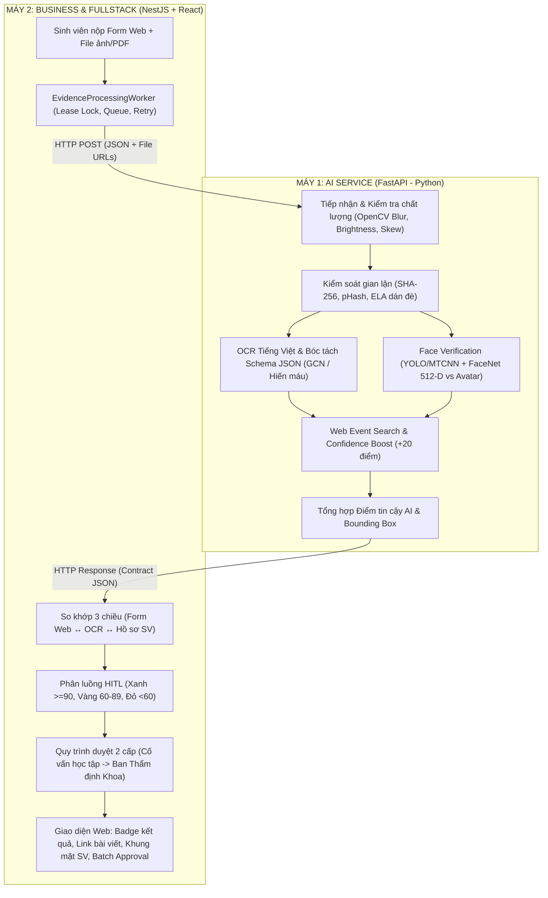

# KẾ HOẠCH PHÂN CHIA THỰC THI PIPELINE MINH CHỨNG (2 MÁY)
**Dự án:** UniProof-AI / EduPoint  
**Phiên bản:** 1.0 — Ngày 07/11/2026  
**Mục tiêu:** Hiện thực hóa Luồng 1 (GCN/PDF), Luồng 2 (Tra cứu đối chiếu sự kiện) và Luồng 3 (Ảnh sự kiện thực tế & Duyệt 2 cấp) chạy song song trên 2 máy độc lập, không xung đột git, có API Contract chuẩn hóa.

---

## I. TỔNG QUAN KIẾN TRÚC & NGUYÊN TẮC PHÂN CHIA 2 MÁY

### 1. Nguyên tắc cốt lõi
1. **Phân tách theo Domain & Năng lực tính toán (Loose Coupling):**
   - **MÁY 1 (AI & Computer Vision Engine):** Máy tính toán nặng (Compute-Heavy). Toàn bộ nằm trong `apps/ai-service` (Python 3.11, FastAPI, PyTorch, OpenCV, OCR, FaceNet, Web Crawler). Không phụ thuộc vào database PostgreSQL hay Prisma của backend. Hoạt động như một Microservice độc lập.
   - **MÁY 2 (Business Workflow, 3-Way Matching, HITL & Fullstack UI):** Nằm trong `apps/backend` (NestJS + Prisma + PostgreSQL) và `apps/web` (React + Vite + Tailwind). Đảm nhiệm lưu trữ dữ liệu, so khớp 3 chiều nghiệp vụ, hàng đợi xử lý nền, quy trình duyệt 2 cấp (Cố vấn -> Khoa) và toàn bộ giao diện tương tác cho Sinh viên / Cán bộ.
2. **Zero Git Conflict:**
   - Máy 1 chỉ commit và thao tác trên: `apps/ai-service/`
   - Máy 2 chỉ commit và thao tác trên: `apps/backend/` và `apps/web/`
3. **API Contract Driven Development:**
   - Định nghĩa trước 100% cấu trúc Request / Response JSON giữa 2 máy. Máy 2 có thể mock dữ liệu để làm UI/BE trước; Máy 1 có thể dùng Swagger `/docs` để test độc lập mà không cần chờ BE.



---

## II. BẢNG PHÂN CHIA TRÁCH NHIỆM (RACI MATRIX)

| Luồng | Lớp / Bước thực thi | Máy phụ trách | Công nghệ & Chi tiết thực hiện |
| :--- | :--- | :---: | :--- |
| **L1** | Lớp 0 & 1: Kiểm tra chất lượng tệp | **Máy 1** | Pillow, OpenCV: format ≤ 8MB, Laplacian blur, độ sáng, góc nghiêng |
| **L1** | Lớp 2: Gian lận số & Trùng lặp | **Máy 1** | SHA-256 hash, pHash (phát hiện chụp lại màn hình, trùng lặp ảnh) |
| **L1** | Lớp 3: OCR toàn văn hành chính | **Máy 1** | PaddleOCR / Tesseract v4 LSTM Tiếng Việt |
| **L1** | Lớp 4: Bóc tách JSON có cấu trúc | **Máy 1** | Regex / LLM Schema (GCN trong/ngoài trường, Giấy hiến máu) |
| **L1** | Lớp 5: So khớp 3 chiều | **Máy 2** | `thefuzz` / Levenshtein khớp tên HĐ, đối chiếu MSSV/Họ tên/CCCD, kiểm tra ngày cấp thuộc kỳ học |
| **L1** | Lớp 6: Mẫu phôi & ELA dán đè | **Máy 1** | Error Level Analysis (ELA) quét vùng chữ dán đè số, so khớp layout phôi DUT |
| **L1** | Lớp 7 & 8: Tính điểm tin cậy & HITL | **Máy 2** | Tổng hợp điểm từ AI và So khớp 3 chiều -> Xanh (≥90), Vàng (60-89), Đỏ (<60) |
| **L2** | B1 & B2: Tạo query & Tra cứu Web | **Máy 1** | Sinh query `"tên hoạt động" "đơn vị" năm` (mọi nguồn công khai), crawler DuckDuckGo / Internal search |
| **L2** | B3: Đối chiếu & Confidence Boost | **Máy 1** | LLM / Text similarity đối chiếu nội dung bài viết -> cộng +20 (nguồn chính thống) hoặc +10 (nguồn khác) |
| **L2** | B4: Trả link đối chứng lên Web | **Máy 2** | Lưu link vào DB, hiển thị thẻ thông báo cho SV và Inspector cho Cán bộ |
| **L3** | Lớp 1: Gian lận số & EXIF | **Máy 1** | SHA-256, pHash, đọc EXIF metadata (thời gian chụp gốc) |
| **L3** | Lớp 2: Face Verification | **Máy 1** | YOLO/MTCNN detect khuôn mặt + FaceNet trích vector 512-D so khớp với Avatar SV (+30 điểm) |
| **L3** | Lớp 3: OCR bối cảnh & Vision | **Máy 1** | Scene OCR đọc backdrop/banner + Vision prompt phân tích không gian sự kiện |
| **L3** | Lớp 4: Tra cứu web sự kiện | **Máy 1** | Tìm kiếm bài viết đối chứng tương tự Luồng 2 |
| **L3** | Lớp 5: Phân hạng tin cậy | **Máy 2** | Phân hạng Hạng B (Vàng mạnh), Hạng C (Vàng yếu), đẩy vào hàng chờ HITL |
| **L3** | Lớp 6: Quy trình duyệt 2 cấp | **Máy 2** | Cố vấn/Lớp duyệt sơ bộ -> Ban thẩm định Khoa duyệt chốt cuối & Batch Approval |

---

## III. CHUẨN GIAO TIẾP API GIỮA 2 MÁY (SHARED API CONTRACT)

### 1. Document Evidence Inspection (Luồng 1 & Luồng 2)
- **Endpoint:** `POST /api/v1/evidence/inspect-document`
- **Request Body (JSON):**
```json
{
  "evidenceId": "uuid-string",
  "termId": "uuid-string",
  "activityName": "Chiến dịch Mùa hè xanh 2026",
  "evidenceType": "GIAY_KHEN", // hoặc "GIAY_HIEN_MAU", "GIAY_XAC_NHAN"
  "declaredStudent": {
    "studentCode": "102210001",
    "fullName": "Nguyễn Văn A",
    "citizenId": "048202000000" // dùng cho hiến máu
  },
  "participationDate": "2026-07-15T00:00:00.000Z",
  "fileUrl": "https://storage.supabase.co/.../certificate.jpg",
  "enableWebSearch": true
}
```

- **Response Body (JSON):**
```json
{
  "success": true,
  "evidenceId": "uuid-string",
  "qualityCheck": {
    "passed": true,
    "blurScore": 142.5, // Laplacian variance (> 100 đạt chuẩn)
    "brightness": 160.2, // 0 - 255
    "skewAngle": 1.2,
    "errorDetails": null
  },
  "forensicCheck": {
    "sha256": "e3b0c44298fc1c149afbf4c8996fb92427ae41e4649b934ca495991b7852b855",
    "pHash": "9f84b2c1a3d5e7f0",
    "elaAnomalyScore": 0.08, // < 0.15 là sạch, > 0.3 nghi vấn dán đè
    "isTampered": false,
    "warnings": []
  },
  "ocrExtraction": {
    "rawText": "TRƯỜNG ĐẠI HỌC BÁCH KHOA\nCHỨNG NHẬN...",
    "studentName": "NGUYỄN VĂN A",
    "studentCode": "102210001",
    "activityName": "Chiến dịch tình nguyện Mùa hè xanh năm 2026",
    "organizer": "Đoàn Thanh niên Trường ĐH Bách khoa",
    "issuedDate": "2026-07-20",
    "certificateNumber": "123/QĐ-ĐTN",
    "confidence": 0.94,
    // Riêng nếu là giấy hiến máu:
    "bloodDonation": {
      "bloodVolumeMl": 350,
      "citizenId": "048202000000",
      "birthDate": "2003-05-10"
    }
  },
  "webVerification": {
    "searched": true,
    "queryUsed": "\"Chiến dịch tình nguyện Mùa hè xanh\" \"Đoàn trường ĐH Bách khoa\" 2026",
    "verifiedArticle": {
      "title": "Đoàn trường ĐH Bách khoa ra quân Chiến dịch Mùa hè xanh 2026",
      "url": "https://dut.udn.vn/tintuc/mua-he-xanh-2026",
      "snippet": "Sáng ngày 15/07/2026, tại hội trường...",
      "matchScore": 0.92
    },
    "confidenceBoost": 20
  },
  "aiConfidenceScore": 92.5, // 0 - 100
  "suggestedTier": "GREEN", // GREEN, YELLOW_STRONG, YELLOW_WEAK, RED
  "recommendations": "Ảnh rõ nét, OCR khớp họ tên MSSV, tìm thấy bài báo đối chứng xác thực trên cổng tin DUT."
}
```

---

### 2. Event Photo Inspection (Luồng 3: Ảnh sự kiện & Nhận diện mặt)
- **Endpoint:** `POST /api/v1/evidence/inspect-event-photo`
- **Request Body (JSON):**
```json
{
  "evidenceId": "uuid-string",
  "activityName": "Ngày hội việc làm Bách Khoa DUT Job Fair 2026",
  "eventPhotoUrl": "https://storage.supabase.co/.../event_photo.jpg",
  "studentAvatarUrl": "https://storage.supabase.co/.../student_avatar.jpg",
  "declaredDate": "2026-04-10T00:00:00.000Z",
  "enableWebSearch": true
}
```

- **Response Body (JSON):**
```json
{
  "success": true,
  "evidenceId": "uuid-string",
  "exifData": {
    "captureDate": "2026-04-10T14:22:10",
    "cameraModel": "iPhone 13",
    "dateMatchesDeclared": true
  },
  "faceVerification": {
    "detectedFacesCount": 3,
    "matched": true,
    "bestSimilarityScore": 0.88, // Cosine similarity (> 0.75 khớp)
    "matchedFaceBoundingBox": {
      "x": 230, "y": 140, "width": 110, "height": 130
    },
    "annotatedPhotoUrl": "https://storage.supabase.co/.../annotated_box.jpg",
    "confidenceBoost": 30
  },
  "sceneVision": {
    "detectedTextInScene": "DUT JOB FAIR 2026 - NGÀY HỘI VIỆC LÀM",
    "sceneContext": "Auditorium / Indoor Hall",
    "contextMatchesActivity": true
  },
  "webVerification": {
    "verifiedArticle": {
      "title": "Bế mạc Ngày hội việc làm DUT Job Fair 2026",
      "url": "https://dut.udn.vn/tintuc/job-fair-2026",
      "snippet": "Hơn 5000 sinh viên tham gia...",
      "matchScore": 0.95
    },
    "confidenceBoost": 15
  },
  "aiConfidenceScore": 85.0,
  "suggestedTier": "YELLOW_STRONG", // Luôn vào HITL duyệt 2 cấp
  "suggestedClassification": "HANG_B", // Hạng B: Vàng mạnh (thấy mặt + có bài báo)
  "recommendations": "Nhận diện trùng khớp khuôn mặt sinh viên trong ảnh sự kiện. Tìm thấy bài báo tổ chức ngày hội việc làm."
}
```

---

## IV. BẢN TASK CHI TIẾT DÀNH CHO MÁY 1 (AI SERVICE)

### Nhiệm vụ:
Xây dựng toàn bộ Python FastAPI Service trong `apps/ai-service/`.

1. **Task 1.1: Môi trường & Dependency Setup (`apps/ai-service/requirements.txt`)**
   - Bổ sung: `opencv-python-headless`, `pillow`, `imagehash`, `thefuzz`, `requests`, `beautifulsoup4`, `timm` (hoặc `facenet-pytorch`).
2. **Task 1.2: Pydantic Data Contract (`src/schemas.py`)**
   - Khai báo trọn vẹn các schemas theo mục III (Request & Response).
3. **Task 1.3: Quality & Forensics Module (`src/quality_forensics.py`)**
   - Viết hàm `check_image_quality(img)`: Laplacian variance, brightness mean, skew detection.
   - Viết hàm `compute_hashes(file_bytes)`: SHA-256 + pHash (ImageHash).
   - Viết hàm `error_level_analysis(img)`: Re-save JPEG với quality 90, tính chênh lệch pixel ELA để phát hiện vùng bị can thiệp.
4. **Task 1.4: OCR & Structured Entity Extractor (`src/ocr_extractor.py`)**
   - Nhận diện text tiếng Việt.
   - Trích xuất Regex & Quy tắc heuristics/LLM: Họ tên, MSSV, Sự kiện, Ngày cấp, Số QĐ, Con dấu. Xử lý mẫu Giấy hiến máu chuyên biệt (thể tích máu, CCCD).
5. **Task 1.5: Web Event Verifier (`src/web_search_verifier.py`)**
   - Xây dựng query: `"tên hoạt động" "đơn vị" năm` (không giới hạn tên miền, tra mọi nguồn công khai).
   - Tìm kiếm qua DuckDuckGo HTML / DUT search scraper.
   - Ưu tiên nguồn chính thống (DUT/đại học/đoàn - hội); so khớp độ tương đồng văn bản bài viết với minh chứng -> tính Confidence Boost (+20 nguồn chính thống, +10 nguồn khác).
6. **Task 1.6: Face Verification & Scene Vision (`src/face_verifier.py`)**
   - Đọc EXIF metadata ngày chụp.
   - Phát hiện mặt và tính Cosine Similarity giữa vector embedding khuôn mặt trong ảnh sự kiện với Avatar của SV.
   - Bounding box tọa độ khuôn mặt sinh viên để trả về cho giao diện web hiển thị.
7. **Task 1.7: Pipeline Orchestrator & FastAPI App (`src/pipeline_orchestrator.py`, `src/main.py`)**
   - Gom toàn bộ logic thành 2 pipeline chính: `process_document_evidence` và `process_event_photo_evidence`.
   - Cung cấp Swagger UI tại `http://localhost:8000/docs`.

---

## V. BẢN TASK CHI TIẾT DÀNH CHO MÁY 2 (BACKEND & FRONTEND)

### Nhiệm vụ:
Mở rộng NestJS backend và React web để tích hợp kết quả AI và thực thi quy trình duyệt 2 cấp.

1. **Task 2.1: Mở rộng Database Schema (Prisma PostgreSQL)**
   - Cập nhật `apps/backend/prisma/schema.prisma`:
     - Thêm trường `verifiedArticleUrl`, `verifiedArticleTitle`, `faceMatchSimilarity`, `faceBoundingBox`, `aiTier` vào `VerificationResult` hoặc `OcrResult`.
     - Enum phân hạng minh chứng sự kiện: `HANG_A`, `HANG_B` (Vàng mạnh), `HANG_C` (Vàng yếu).
2. **Task 2.2: Lớp 5 - Engine So khớp 3 chiều (`apps/backend/src/evidence/three-way-matcher.service.ts`)**
   - Form Web ↔ OCR AI ↔ Database Sinh viên (`User`, `Term`):
     - So khớp định danh: `studentCode`, `fullName` hoặc `citizenId`.
     - So khớp tên hoạt động tự khai với OCR text (dùng Levenshtein / thefuzz).
     - Kiểm tra logic ngày diễn ra/cấp chứng nhận phải nằm trong khoảng thời gian học kỳ `Term.startDate` - `Term.endDate`.
     - Hard gate rejection: Đánh dấu ĐỎ từ chối ngay nếu sai thông tin định danh hoặc sai học kỳ.
3. **Task 2.3: Nâng cấp Worker Hàng đợi (`apps/backend/src/evidence/evidence-processing.worker.ts`)**
   - Gọi API của Máy 1 (`AI_PIPELINE_URL/api/v1/evidence/inspect-document` hoặc `inspect-event-photo`).
   - Xử lý retry (tối đa 3 lần), timeout 60s, lease lock chống trùng lặp.
   - Lưu trữ kết quả AI trả về vào `OcrResult`, `AnomalyFlag`, `VerificationResult`, `AiSuggestion`.
4. **Task 2.4: Luồng duyệt 2 cấp Cố vấn -> Khoa (Backend API)**
   - API cấp 1 (GVCN / Lớp): Xem kết quả AI (khuôn mặt, link bài báo) -> Bấm "Xác nhận sinh viên có tham gia" -> Đẩy lên cấp Khoa.
   - API cấp 2 (Ban thẩm định Khoa): Endpoint `POST /api/evidence/batch-approve` cho các ca Vàng mạnh đã có xác nhận của lớp.
5. **Task 2.5: Giao diện Sinh viên (`apps/web/src/pages/student/`)**
   - Form nộp minh chứng (hỗ trợ chọn loại: Giấy tờ hoặc Ảnh sự kiện tham gia).
   - Thẻ hiển thị trạng thái AI minh bạch:
     - Xanh: "AI tạm tính: HỢP LỆ (92 điểm). Đã tìm thấy bài viết: [Link]".
     - Vàng: "Cần thẩm định bởi Cán bộ/Khoa".
     - Đỏ: "Từ chối kèm lý do chi tiết (Sai họ tên, ngoài học kỳ xét điểm...)".
6. **Task 2.6: Giao diện Cán bộ & Khoa (`apps/web/src/pages/officer/` & `/admin/`)**
   - Inspector View: Hiển thị ảnh sự kiện có vẽ bounding box khuôn mặt sinh viên.
   - Hiển thị link bài báo xác thực kèm snippet đối chiếu.
   - Dashboard Khoa: Nút **"Phê duyệt hàng loạt" (Batch Approval)** cho các ca Vàng mạnh.
