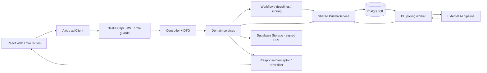

# Kiến trúc và bản đồ nghiệp vụ EduPoint

Đối chiếu 2026-11-15 tại baseline `93fb66c`. Đây là mô tả mã nguồn hiện tại và giới hạn đã biết, không phải chứng nhận hệ thống triển khai hoạt động đúng. Đọc theo thứ tự: kiến trúc → workflow → [quy tắc](BUSINESS_RULES.md) → [audit](BUSINESS_LOGIC_AUDIT.md).

## Mục tiêu sản phẩm và tác nhân

EduPoint hỗ trợ quản lý đánh giá điểm rèn luyện theo kỳ: sinh viên tự đánh giá/nộp minh chứng; cán bộ Khoa thẩm định, xác minh dữ liệu, chốt tiêu chí và gửi snapshot; CTSV tiếp nhận, công bố, điều phối hiệu chỉnh và chốt kỳ. AI hỗ trợ gợi ý; điểm chính thức do người có quyền quyết định.

| Actor trong DB | URL Web | Trách nhiệm chính |
|---|---|---|
| STUDENT | /student | Phiếu và minh chứng của mình, kết quả, bổ sung, phúc khảo |
| STAFF | /officer | Sinh viên thuộc Khoa theo snapshot kỳ; review/attendance/chốt/gửi |
| ADMIN | /admin | Dữ liệu nền, tài khoản, rubric/kỳ/gia hạn, tiếp nhận/công bố/chốt, giám sát |

Không có role enum OFFICER/FACULTY; đó là tên màn hình/đơn vị.

## Kiến trúc thực thi

Frontend: React18, TypeScript5, Vite5, Tailwind3, React Router6, Axios, lucide-react; Excel qua xlsx. Backend: NestJS10, Passport/JWT, class-validator/transformer, Prisma5, PostgreSQL. Các phiên bản là manifest repository, không tuyên bố bản mới nhất.

Không có repository layer riêng: controller → service → Prisma trực tiếp. PostgreSQL/Storage được thiết kế dùng Supabase; chưa kiểm tra deployment hoặc connection thực. Auth hiện là JWT do backend phát, không phải Supabase Auth/SSO.

Worker trong EvidenceModule được khởi tạo cùng backend, poll job DB mỗi 3 giây và gọi AI_PIPELINE_URL; không cần BullMQ/Redis cho đường chạy đang có. Khởi động backend có thể ghi persistent job và gọi pipeline.

## Cấu trúc và phụ thuộc module

| Vùng | Nhiệm vụ / phụ thuộc |
|---|---|
| [apps/web/src](../apps/web/src) | routes, context Auth, layout theo role, pages và hooks; apiClient là lớp HTTP chung |
| [auth](../apps/backend/src/auth) / [users](../apps/backend/src/users) | JWT/password/authVersion; User/Class/Faculty; audit cho quản trị |
| [criteria](../apps/backend/src/criteria) | Kỳ, đơn vị, văn bản, template/version rubric; phụ thuộc workflow khi activate/close và scoring thuần |
| [assessments](../apps/backend/src/assessments) | Tự đánh giá, preflight/nộp/trả, verification/finalize; workflow + deadline + scoring |
| [evaluation-workflow](../apps/backend/src/evaluation-workflow) | Scope, lock Term, roster, snapshot, readiness/send/return/publication/correction/close/export/jobs |
| [deadline-extensions](../apps/backend/src/deadline-extensions) | Resolver hạn cá nhân→lớp→kỳ và lịch sử cấp/thu hồi; workflow/assessments/appeals sử dụng |
| [evidence](../apps/backend/src/evidence) | Nháp/nộp/tệp/bổ sung; Storage và worker; workflow bảo vệ quyền/chuyển trạng thái |
| [reviews](../apps/backend/src/reviews) | Claim/release/review/nguồn xác minh; invalidate điểm, audit, notification, hủy job |
| [activities](../apps/backend/src/activities) | Activity/attendance, xác nhận/thu hồi và recompute; workflow/scoring |
| [appeals](../apps/backend/src/appeals) | Đơn, phạm vi, hạn, giải quyết/mở lại liên quan; workflow/deadline |
| [conduct-scores](../apps/backend/src/conduct-scores) / [reports](../apps/backend/src/reports) | Dashboard/bảng điểm/truy vết, tổng hợp publication/legacy/workflow |
| [notifications](../apps/backend/src/notifications) | Đọc 50 thông báo, số chưa đọc và markRead theo chủ |
| [profile-data-issues](../apps/backend/src/profile-data-issues) | Yêu cầu sửa hồ sơ và phản hồi Admin; resolve không tự thay User |
| [audit-log](../apps/backend/src/audit-log) | Tìm nhật ký, health; lịch sử phiếu còn đi qua workflow.scope |
| [common](../apps/backend/src/common) | PrismaService global, guards/decorators, response envelope, error mapping |

## Bản đồ nghiệp vụ end to end

Mỗi feature dưới đây ghi caller, API/DTO, service, bảng, response, AC và ca biên. Guard JWT/role và service scope phải kiểm tra ở mọi đường vào; UI không thay thế kiểm quyền.

| Feature | Luồng qua các lớp / nơi xem chi tiết |
|---|---|
| [F01 — Tài khoản và phân quyền](features/01-accounts-and-access.md) | Login / Account / UserManagement → apiClient → AuthController, UsersController → AuthService, UsersService, JwtStrategy → User, Class, Faculty, AuditLog. |
| [F02 — Dữ liệu đơn vị và quy chế](features/02-master-data-and-regulations.md) | TermsMasterData / UserManagement / KnowledgeBase → CriteriaController → CriteriaService → Faculty, Class, RegulationDocument, Criterion, AuditLog. |
| [F03 — Kỳ đánh giá và gia hạn](features/03-terms-and-deadlines.md) | TermsMasterData / DeadlineExtensionsDialog → CriteriaController, DeadlineExtensionsController → CriteriaService, WorkflowService.initialize, DeadlineExtensionsService → Term, AssessmentHandoff, AssessmentDeadlineExtension. |
| [F04 — Bộ tiêu chí và công thức điểm](features/04-rubrics-and-scoring.md) | CriteriaManager → CriteriaController → CriteriaService / validateRubricDefinition → RubricVersion, RubricCategory, Criterion; AssessmentsService → evaluateRubricCriterion → snapshot tổng hợp. |
| [F05 — Tự đánh giá của sinh viên](features/05-student-assessment.md) | ScoreReport / useStudentAssessmentAccess → AssessmentsController → AssessmentsService.preflight, submitSelfAssessment → WorkflowService.studentEdit → CriterionAssessment, AssessmentSubmission, Evidence, AiProcessingJob. |
| [F06 — Minh chứng và lưu trữ tệp](features/06-evidence-and-storage.md) | ScoreReport / EvidenceList / EvidenceDetail → EvidenceController → EvidenceService → WorkflowService.studentEdit/scope → Evidence, EvidenceFile, CriterionAssessment → Supabase Storage → URL có thời hạn. |
| [F07 — Duyệt minh chứng và chốt tiêu chí](features/07-evidence-review-and-verification.md) | ReviewQueue / ReviewDetail / StudentAssessment → ReviewsController, AssessmentsController → ReviewsService / AssessmentsService → workflow.edit → Review, VerificationResult, SupplementRequest, CriterionAssessment, AuditLog, Notification. |
| [F08 — Hoạt động và điểm danh](features/08-activities-and-attendance.md) | InternalActivities → ActivitiesController → ActivitiesService.mutate/recomputeActivityCriterion → workflow.lock → Activity, ActivityParticipant, CriterionAssessment, AuditLog. |
| [F09 — Thẩm định và bàn giao Khoa](features/09-faculty-handoff.md) | EvaluationsByClass / EvaluationBoard / StudentAssessment → WorkflowController → WorkflowService.list/snapshot/send/return → khóa Term trong transaction → AssessmentHandoff, CriterionAssessment, Evidence, Appeal, AuditLog. |
| [F10 — Công bố và chốt kỳ](features/10-publication-and-term-closure.md) | ResultsReception / TermsMasterData → WorkflowController.conditions/publish/close → WorkflowService + transaction khóa Term → AssessmentPublication, AssessmentHandoff, Term, AuditLog, Notification. |
| [F11 — Phúc khảo và hiệu chỉnh công bố](features/11-appeals-and-corrections.md) | Appeals / AppealsResolution / ResultsReception → AppealsController, WorkflowController → AppealsService.resolve / WorkflowService correction → Appeal, PublicationCorrectionRequest, AssessmentHandoff, AssessmentPublication. |
| [F12 — Bảng điểm, báo cáo và xuất Excel](features/12-scores-reports-and-exports.md) | Dashboard / ResultReports / useFacultyDashboard → ScoresController, ReportsController, WorkflowController.export → ConductScoresService, ReportsService, WorkflowService → snapshot/publication/assessment → apiClient → Excel. |
| [F13 — Thông báo và liên kết nghiệp vụ](features/13-notifications.md) | NotificationsCenter / AppLayout → NotificationsController → NotificationsService → Notification; các service nghiệp vụ tạo notification trong transaction. |
| [F14 — Nhật ký, giám sát và xử lý AI](features/14-audit-monitoring-and-ai-jobs.md) | Monitoring / AiJobs / AuditLogs → AuditLogController, AiJobsController → service → AuditLog, AiProcessingJob, AiPipelineRun, AiPipelineStep; EvidenceProcessingWorker → pipeline /evidence/process → acceptResult → AiSuggestion. |

Một đường đi trọng tâm:

1. Admin tạo kỳ UPCOMING với bản sao kỹ thuật PUBLISHED từ bộ chuẩn hoặc kỳ nguồn theo DEC-006. Nếu sửa nội dung trước khi mở kỳ, hệ thống tạo phiên bản nháp kế tiếp. Khi còn bản nháp, Admin xác nhận bản đang ban hành để khởi tạo roster theo DEC-013.
2. Kích hoạt tạo AssessmentHandoff cho sinh viên active có lớp: chụp classId/facultyId/rubricVersionId.
3. Sinh viên vào /student/scores, lưu selfScore, tạo Evidence gắn CriterionAssessment, upload file; preflight báo thiếu dữ liệu/tệp.
4. Submit với termId ở query: workflow.studentEdit khóa Term, kiểm quyền/cửa sổ, ghi SUBMITTED, chuyển nháp đủ tệp sang PROCESSING và tạo AiProcessingJob.
5. Worker claim bằng updateMany status, tạo run/step, ký file URL và gọi pipeline; acceptResult kiểm attempt/version/rubric/submission/kỳ/handoff trước ghi suggestions. Không có pipeline thì UNAVAILABLE và chuyển xét thủ công.
6. Khoa review minh chứng hoặc yêu cầu bổ sung, ghi nguồn xác minh; kết luận minh chứng làm mất hiệu lực điểm liên quan, chưa tạo điểm chính thức.
7. Khoa xác minh verifiedData và note, tính suggestion bằng scoring; finalize lưu officialScore/lý do/người chốt. Attendance CONFIRMED là nguồn dữ liệu khác cần nhất quán.
8. Send kiểm toàn bộ tiêu chí, minh chứng và appeal; tạo snapshot/revision, SENT khóa chỉnh sửa. CTSV xem snapshot đó.
9. CTSV trả về Khoa có lý do hoặc publish append publication; sau publish kỳ REVIEWING, sinh viên có thể appeal trong cửa sổ có hiệu lực.
10. Appeal ACCEPTED hoặc correction mở lại xử lý, Khoa chấm/gửi revision mới rồi CTSV công bố lại; publication cũ còn nguyên.
11. Ghi không nộp hoặc loại trừ có căn cứ riêng; chốt chỉ khi đủ publication mới nhất và hết phúc khảo theo điều kiện. Gap gia hạn khi chốt là BL-006, chưa được sửa.

## Mô hình dữ liệu và ràng buộc

[Schema Prisma](../apps/backend/prisma/schema.prisma) có 34 model. Các quan hệ quan trọng:

- Faculty 1–n Class; User có class/faculty hiện tại. AssessmentHandoff giữ snapshot lịch sử, không dùng thay nhau.
- Term 1–n RubricVersion; version có category/criterion; template/version mẫu là nguồn copy độc lập.
- CriterionAssessment unique(studentId,termId,criterionId), tách selfScore/verifiedData/suggestedScore/officialScore.
- Submission unique(student,term,rubric); Handoff unique(student,term); Publication unique(student,term,revision), snapshot JSON.
- Evidence nối student/term/activity? và CriterionAssessment?, có files, review, nguồn xác minh, supplement, suggestion, jobs/runs/steps.
- Appeal nối student và tùy loại evidence/criterion/publicationRevision; Correction giữ sourcePublication/revision và handoff.
- DeadlineExtension dùng targetType/targetId đa hình; không có FK trực tiếp targetId đến cả User/Class, service cần kiểm hợp lệ.
- Notification.dedupeKey unique; ProfileDataIssue giữ currentData/resolution; AuditLog lưu actor/action/entity/old/new.
- FK/unique không thay thế kiểm đúng kỳ/rubric/Khoa. Không khẳng định mọi invariant có CHECK/trigger DB.

Danh mục model (cột quan hệ chỉ các trường khai báo @relation; collection inverse không liệt kê đầy đủ):

| Model / nguồn | Quan hệ có @relation | Unique tổng hợp |
|---|---|---|
| [Faculty](../apps/backend/prisma/schema.prisma#L28) | staffs User[] | Xem @id/@unique trường trong schema |
| [Class](../apps/backend/prisma/schema.prisma#L38) | faculty Faculty; students User[] | Xem @id/@unique trường trong schema |
| [User](../apps/backend/prisma/schema.prisma#L50) | class Class?; faculty Faculty?; assessmentHandoffs AssessmentHandoff[]; sentHandoffs AssessmentHandoff[]; assessmentPublications AssessmentPublication[]; publishedResults AssessmentPublication[]; evidences Evidence[]; lockedEvidences Evidence[]; reviews Review[]; appeals Appeal[]; resolvedAppeals Appeal[]; criterionAssessments CriterionAssessment[]; recordedClassAssessments CriterionAssessment[]; finalizedCriterionAssessments CriterionAssessment[]; selfAssessmentSubmissions AssessmentSubmission[]; returnedAssessmentSubmissions AssessmentSubmission[]; reportedProfileIssues ProfileDataIssue[]; resolvedProfileIssues ProfileDataIssue[]; createdDeadlineExtensions AssessmentDeadlineExtension[]; revokedDeadlineExtensions AssessmentDeadlineExtension[]; requestedCorrections PublicationCorrectionRequest[]; excludedHandoffs AssessmentHandoff[] | Xem @id/@unique trường trong schema |
| [Term](../apps/backend/prisma/schema.prisma#L106) | — | Xem @id/@unique trường trong schema |
| [Activity](../apps/backend/prisma/schema.prisma#L141) | — | Xem @id/@unique trường trong schema |
| [ActivityParticipant](../apps/backend/prisma/schema.prisma#L160) | activity Activity; student User | [activityId, studentId] |
| [RegulationDocument](../apps/backend/prisma/schema.prisma#L190) | uploadedBy User | Xem @id/@unique trường trong schema |
| [RegulationChunk](../apps/backend/prisma/schema.prisma#L206) | regulationDocument RegulationDocument | Xem @id/@unique trường trong schema |
| [Criterion](../apps/backend/prisma/schema.prisma#L217) | rubricVersion RubricVersion?; rubricCategory RubricCategory?; regulationDocument RegulationDocument? | [rubricVersionId, code] |
| [RubricVersion](../apps/backend/prisma/schema.prisma#L249) | term Term; sourceTemplateVersion RubricTemplateVersion? | [termId, version] |
| [RubricTemplate](../apps/backend/prisma/schema.prisma#L274) | — | Xem @id/@unique trường trong schema |
| [RubricTemplateVersion](../apps/backend/prisma/schema.prisma#L282) | template RubricTemplate | [templateId, version] |
| [RubricCategory](../apps/backend/prisma/schema.prisma#L299) | rubricVersion RubricVersion | [rubricVersionId, code] |
| [AssessmentSubmission](../apps/backend/prisma/schema.prisma#L325) | student User; term Term; rubricVersion RubricVersion; returnedBy User? | [studentId, termId, rubricVersionId] |
| [AssessmentHandoff](../apps/backend/prisma/schema.prisma#L354) | student User; term Term; rubricVersion RubricVersion; class Class; faculty Faculty; sentBy User?; excludedBy User? | [studentId, termId] |
| [AssessmentPublication](../apps/backend/prisma/schema.prisma#L388) | student User; term Term; rubricVersion RubricVersion; publishedBy User | [studentId, termId, revision] |
| [CriterionAssessment](../apps/backend/prisma/schema.prisma#L408) | student User; term Term; criterion Criterion; classEvaluator User?; finalReviewer User? | [studentId, termId, criterionId] |
| [Evidence](../apps/backend/prisma/schema.prisma#L459) | student User; term Term; criterionAssessment CriterionAssessment?; activity Activity?; lockedBy User? | Xem @id/@unique trường trong schema |
| [EvidenceFile](../apps/backend/prisma/schema.prisma#L500) | evidence Evidence | Xem @id/@unique trường trong schema |
| [AiProcessingJob](../apps/backend/prisma/schema.prisma#L522) | evidence Evidence | Xem @id/@unique trường trong schema |
| [AiPipelineRun](../apps/backend/prisma/schema.prisma#L539) | job AiProcessingJob; evidence Evidence | [jobId, attempt] |
| [AiPipelineStep](../apps/backend/prisma/schema.prisma#L564) | run AiPipelineRun | Xem @id/@unique trường trong schema |
| [OcrResult](../apps/backend/prisma/schema.prisma#L583) | evidenceFile EvidenceFile; evidence Evidence | Xem @id/@unique trường trong schema |
| [VerificationResult](../apps/backend/prisma/schema.prisma#L613) | evidence Evidence | Xem @id/@unique trường trong schema |
| [AnomalyFlag](../apps/backend/prisma/schema.prisma#L636) | evidence Evidence | Xem @id/@unique trường trong schema |
| [AiSuggestion](../apps/backend/prisma/schema.prisma#L649) | evidence Evidence; criterion Criterion? | Xem @id/@unique trường trong schema |
| [Review](../apps/backend/prisma/schema.prisma#L675) | evidence Evidence; reviewer User; criterion Criterion? | Xem @id/@unique trường trong schema |
| [SupplementRequest](../apps/backend/prisma/schema.prisma#L694) | evidence Evidence; review Review | Xem @id/@unique trường trong schema |
| [Appeal](../apps/backend/prisma/schema.prisma#L714) | evidence Evidence?; student User; resolver User?; term Term?; criterionAssessment CriterionAssessment? | Xem @id/@unique trường trong schema |
| [AuditLog](../apps/backend/prisma/schema.prisma#L746) | user User | Xem @id/@unique trường trong schema |
| [Notification](../apps/backend/prisma/schema.prisma#L762) | user User; relatedEvidence Evidence? | Xem @id/@unique trường trong schema |
| [ProfileDataIssue](../apps/backend/prisma/schema.prisma#L788) | reporter User; resolver User? | Xem @id/@unique trường trong schema |
| [AssessmentDeadlineExtension](../apps/backend/prisma/schema.prisma#L818) | term Term; createdBy User; revokedBy User? | Xem @id/@unique trường trong schema |
| [PublicationCorrectionRequest](../apps/backend/prisma/schema.prisma#L844) | term Term; handoff AssessmentHandoff; sourcePublication AssessmentPublication; requestedBy User | Xem @id/@unique trường trong schema |

## Migrations

Chỉ kiểm tra nguồn, không áp dụng hoặc reset database. Thứ tự:

| Migration | Mục đích theo tên/nội dung nguồn |
|---|---|
| [20261018000000_baseline_existing_supabase](../apps/backend/prisma/migrations/20261018000000_baseline_existing_supabase/migration.sql) | Baseline PostgreSQL/Supabase hiện có |
| [20261019000100_add_versioned_dut_rubric](../apps/backend/prisma/migrations/20261019000100_add_versioned_dut_rubric/migration.sql) | Rubric DUT có phiên bản |
| [20261019000200_rubric_templates](../apps/backend/prisma/migrations/20261019000200_rubric_templates/migration.sql) | Mẫu rubric |
| [20261019000300_drop_legacy_criterion_code_unique](../apps/backend/prisma/migrations/20261019000300_drop_legacy_criterion_code_unique/migration.sql) | Bỏ unique code tiêu chí legacy |
| [20261020000100_self_assessment_submission_and_ai_jobs](../apps/backend/prisma/migrations/20261020000100_self_assessment_submission_and_ai_jobs/migration.sql) | Submission và job AI bền vững |
| [20261026000100_ai_pipeline_runs](../apps/backend/prisma/migrations/20261026000100_ai_pipeline_runs/migration.sql) | Lượt/bước pipeline AI |
| [20261027000100_faculty_handoff_publication](../apps/backend/prisma/migrations/20261027000100_faculty_handoff_publication/migration.sql) | Bàn giao Khoa và publication |
| [20261027000200_drop_legacy_rule_and_conduct_score](../apps/backend/prisma/migrations/20261027000200_drop_legacy_rule_and_conduct_score/migration.sql) | Loại bảng rule/conduct score legacy |
| [20261102000100_workflow_integrity](../apps/backend/prisma/migrations/20261102000100_workflow_integrity/migration.sql) | Ràng buộc và tính toàn vẹn workflow |
| [20261107000100_auth_session_version](../apps/backend/prisma/migrations/20261107000100_auth_session_version/migration.sql) | authVersion và thu hồi phiên |
| [20261107000200_activity_participant_lifecycle](../apps/backend/prisma/migrations/20261107000200_activity_participant_lifecycle/migration.sql) | Vòng đời điểm danh |
| [20261107000300_core_workflow_completion](../apps/backend/prisma/migrations/20261107000300_core_workflow_completion/migration.sql) | Profile issue, gia hạn, hiệu chỉnh và luồng lõi |

Migrations là lịch sử repo, không chứng minh deployed database đã chạy đầy đủ. Seed định nghĩa dữ liệu đầu kỳ/mẫu và tài khoản thử; không chạy để xem kiến trúc.

Compose dùng `pgvector/pgvector:pg17`, volume PG17 riêng và bật extension `vector` trong schema `public` khi khởi tạo volume mới. Quy trình [dựng PostgreSQL local](TEST_PLAN.md#postgresql-17-local) giữ nguyên các migration đã phát hành.

## Điều hướng và trách nhiệm màn hình

Nguồn: [roleNavigation](../apps/web/src/lib/roleNavigation.ts), [routes](../apps/web/src/routes.tsx).

| Vai trò | 5 nhóm chính hiện tại |
|---|---|
| STAFF | Tổng quan Khoa (/officer); Thẩm định đánh giá (/officer/evaluations); Phúc khảo (/officer/appeals); Hoạt động & điểm danh (/officer/activities); Tiêu chí & quy chế (/officer/criteria) |
| ADMIN | Bảng điều hành (/admin); Tiếp nhận & Công bố (/admin/results); Dữ liệu & Kỳ đánh giá (/admin/terms); Quản lý tài khoản (/admin/users); Giám sát & Nhật ký (/admin/monitoring) |

STUDENT vào bảng điểm /student/scores để tự đánh giá và gắn minh chứng; các route evidence/new, criteria, what-can-i-claim redirect tại đây. officer/external-activities→activities; officer/reports và students/legacy→phần kết quả Tổng quan. admin/rules→criteria; các AI-center/config/ground-truth/evaluation redirect về admin; audit-logs/health→monitoring. reset-password→forgot-password; organizer-confirm→login. File màn hình tồn tại nhưng route redirect không chứng minh tính năng đó đang dùng.

Navigation mang kỳ; returnTo nội bộ hợp lệ khôi phục bộ lọc; refresh/Back/Forward và active state cần nghiệm thu. Nhóm Thẩm định có tab Theo lớp và Hàng đợi minh chứng & AI; Phúc khảo là menu riêng. Student đang có gap đồng bộ kỳ URL/context (BL-024).

## Tổng quan Khoa và số liệu biểu đồ được giữ lại

- Tổng quan có KPI, ba deadline, danh sách việc và kết quả công bố. Ba biểu đồ: 8 state thanh ngang; mỗi lớp thanh chồng 100%; donut minh chứng.
- Nhóm lớp: notSubmitted; processing = REVIEWING+STUDENT_RETURNED+FACULTY_RETURNED; ready; handedOver = SENT+PUBLISHED; recordedNotSubmitted. Không đếm trùng, ghi không nộp không là bàn giao.
- Ưu tiên lớp theo tỷ lệ còn phải bàn giao giảm dần, rồi số lượng. Ban đầu 8 lớp, có mở rộng, bảng thay thế, liên kết bàn phím.
- Donut phần còn lại = total-approved-rejected; không gọi tất cả phần còn lại là pending cán bộ. Tổng0 hiển thị empty.
- Hook tải workflow đủ trang 100, tối đa 4 request đồng thời; kiểm total, studentId trùng, state và summary. Thiếu trang không vẽ như dữ liệu hoàn chỉnh.
- Workflow/KPI/report có loading/error/retry riêng; không biến lỗi thành0. Key user/kỳ/generation chặn response cũ.
- /officer/evaluations riêng có 4 KPI hành động, bảng lớp và panel; bộ lọc lớp không làm KPI Khoa biến thành KPI trang hiện tại.
- Badge “đã quyết định” = APPROVED+REJECTED, hai list phân trang riêng. Tab appeal sinh viên lazy-load đủ trang Khoa/kỳ rồi lọc.
- Excel export toàn tập lọc và publication mới nhất, không chỉ trang nhìn thấy. Kỳ lịch sử/đã CLOSED thể hiện chỉ xem.

Nguồn: [facultyAnalytics](../apps/web/src/lib/facultyAnalytics.ts), [useFacultyDashboard](../apps/web/src/hooks/useFacultyDashboard.ts), [FacultyCharts](../apps/web/src/components/officer/FacultyCharts.tsx).

## Inventory và độ hoàn thiện

Inventory tracked baseline: 255 file, 16 controller, 16 service, 89 file trong Web src, 40 file tracked rỗng. Không rà line by line node_modules, dist, binary model/image hoặc lockfile sinh tự động.

| Vùng | Phân loại và giới hạn |
|---|---|
| Web/NestJS/Prisma chính | Có implementation; audit có 7 finding đã xử lý (BL-001, BL-002, BL-006, BL-007, BL-009, BL-010, BL-020), 20 finding mở |
| apps/mobile | Nhiều màn/config rỗng; không có bằng chứng mobile workflow hoạt động |
| apps/ai-service | Python main/schemas/tokenizer/predictor và nhiều asset scaffold/rỗng; không coi FastAPI là backend chính |
| packages/ai-core, research | Nhiều file scaffold/dataset/script rỗng; không chứng minh model đã train/evaluate |
| jobs/queue.module và processor | Scaffold; đường chạy thật hiện tại là EvidenceProcessingWorker DB poller |
| AI admin screens/organizer/reset legacy | Một số file còn nhưng redirect/không reach được từ luồng chính; cần kiểm route trước khi dùng |
| Root package/workspace manifest | Chưa có orchestration đầy đủ; dùng script thực tế trong apps/web và apps/backend |
| Tài liệu bàn giao 02/11 được link trong docs cũ | Không có file trong repo, không phục dựng nội dung như sự thật; Q-08 |

## Kiểm chứng và bước tiếp theo

Các test hiện có: worker unit; faculty analytics unit; workflow integration; browser-smoke/ux-checks và navigation/faculty charts harness. Integration/browser tạo fixture DB và có thể start backend; không thực thi trong đợt tài liệu. Kết quả historical và kế hoạch regression ghi ở [TEST_PLAN](TEST_PLAN.md).

Chưa xác nhận deployed schema, Storage policy/object, pipeline thật, browser/runtime hoặc hiệu năng. Bản đồ này để người làm tiếp tìm đúng luồng và gap; không thay báo cáo nghiệm thu.

