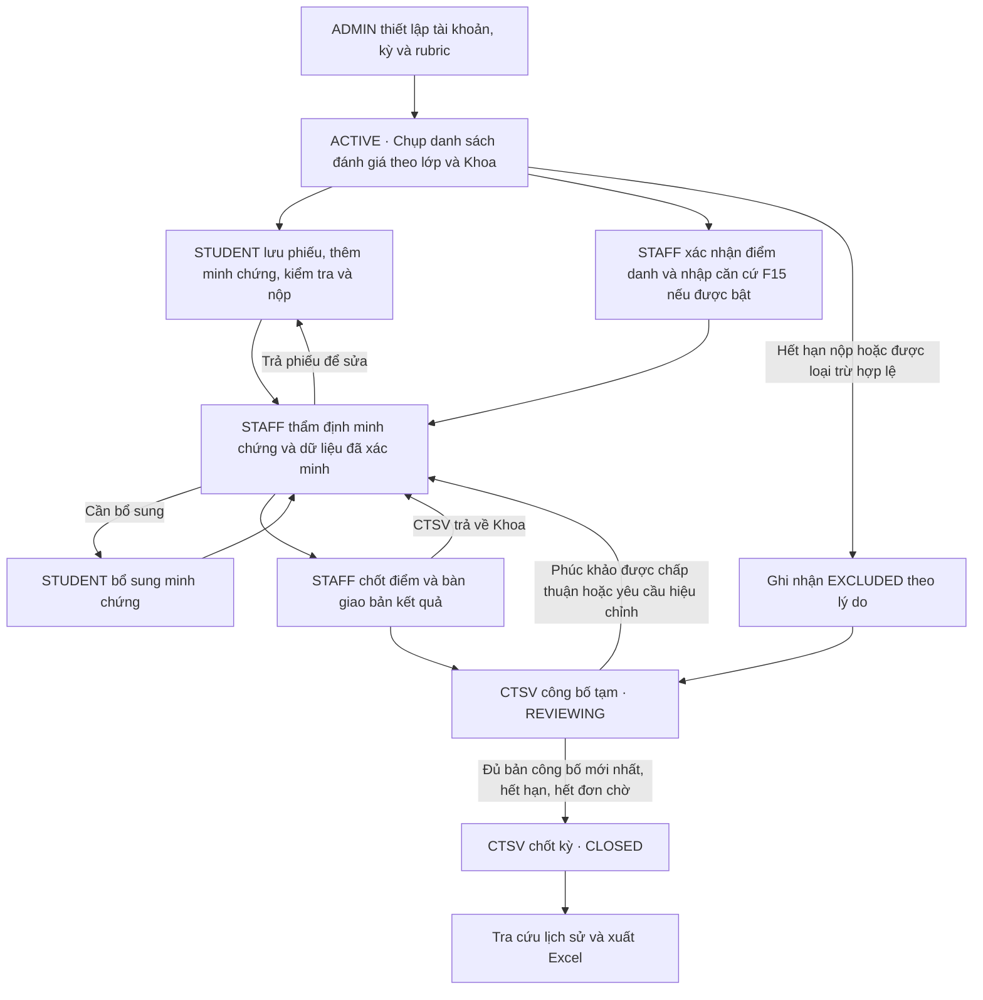

# Báo cáo luồng nghiệp vụ và các trường hợp xử lý của EduPoint

**Mốc đối chiếu** · Commit `11a2d3c`, ngày 23/11/2026

**Phạm vi** · Web và Backend, từ cấu hình kỳ đến chốt sổ và tra cứu lịch sử

EduPoint quản lý đánh giá điểm rèn luyện theo kỳ. Sinh viên khai điểm và cung cấp minh chứng. Cán bộ Khoa kiểm tra căn cứ, xác minh và chốt điểm. Phòng Công tác sinh viên (CTSV) tiếp nhận bản kết quả do Khoa gửi, công bố cho sinh viên và chốt kỳ. Hệ thống lưu phiên bản bộ tiêu chí và từng lần công bố để truy lại kết quả đã áp dụng.

Báo cáo dùng mã use case chính từ bản thảo hiện có, bổ sung các trường hợp thực tế trong mã nguồn. Các ví dụ dùng dữ liệu giả định. [Bản thảo đề tài](BAO_CAO_EDUPOINT_BAN_THAO.md) · [Tổng quan dự án](../PROJECT_OVERVIEW.md) · [Đặc tả F01–F15](../README.md)

## 1. Vai trò và dữ liệu theo kỳ

| Vai trò | Thao tác chính | Phạm vi |
|---|---|---|
| Sinh viên `STUDENT` | Lưu và nộp phiếu, tải minh chứng, bổ sung hồ sơ, xem điểm, gửi phúc khảo | Hồ sơ của chính mình trong kỳ được phép |
| Cán bộ Khoa `STAFF` | Duyệt minh chứng, quản lý điểm danh, nhập căn cứ, xác minh/chốt điểm, bàn giao và giải quyết phúc khảo | Sinh viên thuộc Khoa theo danh sách đã chụp khi mở kỳ |
| Quản trị viên hoặc CTSV `ADMIN` | Quản lý tài khoản, kỳ và rubric. Tiếp nhận, trả Khoa, công bố, điều phối hiệu chỉnh, gia hạn và chốt sổ | Dữ liệu được cấp quyền theo chức năng. Việc ghi điểm trong workflow mới thuộc cán bộ Khoa |

Bộ tiêu chí (rubric) quy định tiêu chí, trần điểm và công thức. Khi mở kỳ, danh sách đánh giá lưu lớp, Khoa và phiên bản rubric tại thời điểm kích hoạt. Nếu sinh viên chuyển lớp, Khoa phụ trách phiếu của kỳ đã mở vẫn được xác định theo bản ghi này. [Mã phân quyền và khởi tạo danh sách kỳ](../../apps/backend/src/evaluation-workflow/workflow.service.ts#L23)

| Đối tượng | Trạng thái hoặc mốc quan trọng |
|---|---|
| Kỳ đánh giá | `UPCOMING` → `ACTIVE` → `REVIEWING` khi công bố tạm → `CLOSED` khi chốt sổ |
| Phiếu tự đánh giá | `DRAFT` → `SUBMITTED`. Khoa có thể trả về `RETURNED` để sinh viên sửa và nộp lại |
| Minh chứng | `DRAFT` → xử lý hoặc chờ duyệt → `APPROVED`, `REJECTED` hoặc `NEEDS_SUPPLEMENT`. Bổ sung hợp lệ đưa hồ sơ qua lượt xử lý mới |
| Điểm tiêu chí | `NEEDS_VERIFICATION` → `READY_FOR_REVIEW` → `FINALIZED`. Một số thay đổi căn cứ làm điểm cũ mất hiệu lực |
| Hồ sơ bàn giao | `WORKING` hoặc `RETURNED` → `SENT`. Nhánh không nộp hoặc loại trừ dùng `EXCLUDED` |
| Kết quả công bố | Mỗi revision đủ điều kiện được lưu thành một bản kết quả. Sinh viên xem revision đã công bố mới nhất |
| Đơn phúc khảo | `PENDING` → `ACCEPTED` hoặc `REJECTED` |

Trạng thái ở mỗi hàng thuộc một đối tượng riêng. Sinh viên nộp phiếu thì phiếu là `SUBMITTED`. Khoa bàn giao thì hồ sơ bàn giao là `SENT`. Chỉ khi CTSV công bố mới có điểm công bố để sinh viên tra cứu. [Mô hình Prisma](../../apps/backend/prisma/schema.prisma) · [Trạng thái nghiệp vụ](../BUSINESS_RULES.md)

## 2. Luồng tổng thể

Nhánh điểm danh và nhập căn cứ có thể diễn ra song song với tự đánh giá. Trước khi gửi lên CTSV, Khoa phải xử lý hết các điều kiện chặn của từng phiếu. [Kiểm tra bàn giao, công bố và chốt kỳ](../../apps/backend/src/evaluation-workflow/workflow.service.ts)

## 3. Luồng chi tiết và kết quả từng trường hợp

### 3.1. Đăng nhập, tài khoản và dữ liệu nền · UC01, UC08

**Luồng chính.** Admin cấu hình Khoa và lớp, tạo hoặc nhập tài khoản, gán sinh viên vào lớp và cán bộ vào Khoa. Người dùng đăng nhập bằng tài khoản được cấp. Với tài khoản phải đổi mật khẩu lần đầu, người dùng hoàn thành bước này trước khi dùng các chức năng nghiệp vụ. Sau đăng nhập, Web điều hướng theo vai trò và Backend kiểm quyền trên từng yêu cầu.

| Trường hợp | Kết quả mong đợi |
|---|---|
| Sinh viên dùng tài khoản mới | Đổi mật khẩu tạm. Sau khi đăng nhập lại, vào khu vực sinh viên |
| Admin khóa tài khoản hoặc cấp lại mật khẩu tạm | Phiên cũ mất hiệu lực. Tài khoản bị khóa bị từ chối ở lần gọi tiếp theo |
| Quên mật khẩu | Màn hình hướng dẫn liên hệ Admin vì gửi email đặt lại mật khẩu chưa được cấu hình. Admin có thể cấp mật khẩu tạm |
| Cán bộ Khoa A mở hồ sơ thuộc Khoa B | Backend từ chối theo Khoa đã chụp của kỳ |
| Văn bản hết hiệu lực nhưng còn liên kết tiêu chí | Giữ liên kết để tra cứu lịch sử. Thao tác xóa bị chặn khi văn bản còn được tham chiếu |
| Người dùng yêu cầu sửa dữ liệu hồ sơ | Admin xem và phản hồi yêu cầu. Nếu cần đổi thông tin tài khoản, Admin thực hiện thao tác cập nhật riêng |

[F01](../features/01-accounts-and-access.md) · [F02](../features/02-master-data-and-regulations.md) · [Xử lý quên mật khẩu](../../apps/backend/src/auth/auth.service.ts#L121) · [Xử lý yêu cầu sửa hồ sơ](../../apps/backend/src/profile-data-issues/profile-data-issues.service.ts)

### 3.2. Tạo kỳ, áp dụng rubric và mở kỳ · UC08

**Luồng chính.** Admin nhập thông tin kỳ, các hạn nộp, thẩm định và phúc khảo. Admin chọn nguồn rubric là bộ chuẩn hoặc rubric của một kỳ đã ban hành. Hệ thống tạo bản `PUBLISHED` riêng cho kỳ mới. Khi kích hoạt, Backend kiểm tra phiên bản áp dụng và tạo danh sách sinh viên đang hoạt động, có lớp.

| Trường hợp | Kết quả mong đợi |
|---|---|
| Kỳ mới dùng nguyên bộ tiêu chí | Kích hoạt trực tiếp bằng bản kế thừa `PUBLISHED` |
| Cần thay đổi tiêu chí trước khi mở kỳ | Lưu bản nháp phiên bản kế tiếp. Ban hành bản sửa thì bản trước cùng kỳ chuyển `ARCHIVED`. Rubric kỳ nguồn vẫn truy vết được |
| Có bản sửa nháp nhưng muốn mở bằng bản đang ban hành | Admin xác nhận đúng bản `PUBLISHED`. Danh sách kỳ tham chiếu bản đó. Bản nháp giữ để tra cứu |
| Có kỳ `ACTIVE` khác hoặc chưa có rubric `PUBLISHED` | Backend từ chối kích hoạt |
| Sinh viên chuyển lớp/Khoa sau khi mở kỳ | Phiếu kỳ đang xử lý dùng lớp và Khoa trong danh sách đã chụp. Trường hợp cần bổ sung người mới vào danh sách là câu hỏi nghiệp vụ Q-04 |

[F03](../features/03-terms-and-deadlines.md) · [F04](../features/04-rubrics-and-scoring.md) · [DEC-006/013 và Q-04](../DECISIONS.md) · [Kích hoạt kỳ](../../apps/backend/src/criteria/criteria.service.ts#L784)

### 3.3. Tự đánh giá và nộp phiếu · UC02

**Luồng chính.** Sinh viên mở phiếu đúng kỳ, nhập điểm theo tiêu chí, lưu nháp và gắn minh chứng nếu có. Preflight báo thiếu điểm, vượt trần nhóm hoặc nháp thiếu dữ liệu. Khi sinh viên bấm **Nộp phiếu**, Backend khóa hàng `Term`, đọc lại hạn, rubric, điểm và minh chứng, rồi ghi `SUBMITTED` nếu hợp lệ.

| Trường hợp | Kết quả mong đợi |
|---|---|
| Điểm đã nhập đầy đủ và nháp hợp lệ | Ghi nhận thời điểm nộp. Tệp hợp lệ đi vào hàng xử lý và phiếu chuyển sang trạng thái chờ Khoa |
| Điểm bằng `0` hoặc chưa nhập | `0` là một giá trị hợp lệ. Ô chưa nhập là dữ liệu thiếu và có thể chặn nộp |
| Một tab xóa điểm hoặc lưu vượt trần trong lúc tab khác nộp | Kết quả phụ thuộc thứ tự lấy khóa. Nếu thay đổi dữ liệu commit trước, trình nộp đọc dữ liệu mới và từ chối |
| Phiếu đã `SUBMITTED` | Không sửa hoặc xóa nháp vừa nộp qua luồng sinh viên |
| Khoa trả phiếu có lý do | Phiếu thành `RETURNED`. Hệ thống xóa điểm gợi ý và điểm đã chốt trên phiếu để xác minh lại. Sinh viên sửa và nộp lại trong cửa sổ hạn thẩm định hiệu lực |
| Sinh viên có gia hạn nộp | Quyền sửa và nộp dùng hạn đang có hiệu lực cho người đó |

[F05](../features/05-student-assessment.md) · [Nộp và trả phiếu](../../apps/backend/src/assessments/assessments.service.ts#L403) · [Kiểm thử đồng thời](../../apps/backend/test/submission-concurrency.integration.test.cjs)

### 3.4. Minh chứng, AI, duyệt và bổ sung · UC03

**Luồng chính.** Sinh viên tạo nháp gắn với tiêu chí, tải tệp và nộp cùng phiếu. Backend ghi job cho nháp có tệp. Worker có thể gọi pipeline ngoài rồi chuyển hồ sơ sang chờ cán bộ. Cán bộ Khoa nhận hồ sơ, kiểm tra căn cứ và đưa ra kết luận duyệt, từ chối hoặc yêu cầu bổ sung.

| Trường hợp | Kết quả mong đợi |
|---|---|
| Kỳ F15, nháp không có tệp và mô tả từ 10 ký tự sau khi bỏ khoảng trắng đầu/cuối | Khi nộp phiếu, minh chứng sang `NEEDS_HUMAN_REVIEW`, không tạo job cho nháp này |
| Kỳ truyền thống, nháp không tệp | Chặn nộp và yêu cầu bổ sung tệp hoặc xử lý nháp |
| Pipeline AI chưa có cấu hình | Job chuyển `UNAVAILABLE`, hồ sơ chuyển sang chờ cán bộ. Điểm chính thức do cán bộ chốt |
| Hai cán bộ nhận cùng hồ sơ hoặc gửi quyết định trên phiên bản cũ | Khóa hồ sơ và kiểm phiên bản ngăn quyết định ghi đè. Web yêu cầu tải lại nếu xung đột |
| Cán bộ yêu cầu bổ sung | Lưu mục còn thiếu và hạn. Dashboard sinh viên gọi danh sách theo `NEEDS_SUPPLEMENT`, kể cả hồ sơ nằm ngoài trang mặc định |
| Sinh viên bổ sung trong hạn | Gửi tệp, giải trình hoặc liên kết hợp lệ. Hệ thống đóng yêu cầu đang mở, tăng version và đưa hồ sơ qua lượt xử lý mới. Điểm liên quan cần xác minh lại |
| Bổ sung quá hạn, truy cập hồ sơ người khác hoặc phiếu đã bị khóa | Backend từ chối. Hạn bổ sung dùng hạn của yêu cầu, nếu thiếu thì dùng `reviewDeadline` của kỳ |
| Tệp đã lưu nhưng ký URL xem tệp thất bại | Hồ sơ và tệp đã lưu được bảo toàn. Web báo chưa có liên kết xem |

Kết luận **Duyệt minh chứng** cho biết căn cứ đã được xem xét. Cán bộ thực hiện bước xác minh và chốt điểm theo tiêu chí ở luồng riêng. [F06](../features/06-evidence-and-storage.md) · [F07](../features/07-evidence-review-and-verification.md) · [Mã bổ sung minh chứng](../../apps/backend/src/evidence/evidence.service.ts#L379) · [Worker](../../apps/backend/src/evidence/evidence-processing.worker.ts)

### 3.5. Hoạt động, điểm danh và nhập căn cứ Excel · UC05, UC09

**Điểm danh.** Cán bộ tạo hoạt động theo kỳ và tiêu chí, thêm người tham gia, rồi xác nhận điểm danh. Chỉ điểm danh `CONFIRMED` được tính. Thu hồi giữ lịch sử và tính lại tiêu chí liên quan. Khi điểm danh và minh chứng cùng một `activityId`, hệ thống tính hoạt động một lần và ưu tiên vai trò đã xác nhận qua điểm danh.

**Nhập Excel F15.** Chọn đúng kỳ và danh mục, dùng mẫu tương ứng, tải tệp để xem trước kết quả từng dòng, sau đó xác nhận. Backend kiểm lại trạng thái kỳ, cờ F15, phạm vi và dữ liệu trước khi ghi. Các nguồn gồm học vụ, điểm danh hoạt động và CLB/BTC. Form chỉ mở ở kỳ `ACTIVE` hoặc `REVIEWING` có bật F15. Lịch sử vẫn xem được theo quyền.

| Trường hợp | Kết quả mong đợi |
|---|---|
| MSSV có số 0 ở đầu hoặc ô căn cứ bị bỏ trống | Giữ MSSV dạng văn bản. Ô thiếu giữ trạng thái thiếu dữ liệu |
| Xem trước kỳ A rồi chuyển sang kỳ B | Phiên xem trước cũ mất hiệu lực. Backend từ chối nếu kỳ xác nhận khác kỳ xem trước |
| Gửi lại cùng khóa idempotency trong đúng kỳ | Trả lô đã ghi nếu khóa còn hợp lệ, tránh tạo thêm dữ liệu |
| Thành viên CLB/BTC ở tiêu chí 4 hoặc 13 | Khoa xem tên đơn vị, vai trò và nguồn nhập. `eligibleMembership` hoặc `organizerConfirmation` cần được xác minh theo cấu hình tiêu chí trước khi tạo điểm gợi ý |
| Có nhiều nguồn CLB, thu hồi một lô hợp lệ | Bỏ liên kết tới nguồn đã thu hồi, giữ nguồn còn hiệu lực và dữ liệu xác minh thủ công |
| Thu hồi có tiêu chí liên quan đã `FINALIZED`, phiếu `SENT`, hoặc đã có publication | Chặn toàn bộ lô. Nhánh CLB còn chặn phiếu `EXCLUDED` |
| Admin tắt F15 khi còn lô `ACTIVE` | Backend yêu cầu xử lý các lô còn hiệu lực trước |
| Thiếu cấu hình điểm vai trò cộng đồng hoặc nguồn mâu thuẫn | Thiếu bảng điểm vai trò có thể chặn xác nhận danh sách điểm danh. Khi bộ tính điểm gặp dữ liệu chưa đủ hoặc vai trò mâu thuẫn, tiêu chí cần được xác minh tiếp |

[F08](../features/08-activities-and-attendance.md) · [F15](../features/15-evidence-grounding-and-batch-finalize.md) · [Quyết định về gộp nguồn và thu hồi](../DECISIONS.md) · [Suite nhập và thu hồi](../../apps/backend/test/grounding-db.integration.test.cjs)

### 3.6. Xác minh căn cứ và chốt điểm · UC04

**Luồng chính.** Cán bộ mở phiếu sinh viên, đối chiếu điểm danh, minh chứng và nguồn nhập. Cán bộ ghi dữ liệu xác minh cùng ghi chú. Hệ thống tính `suggestedScore` theo rubric. Khi dữ liệu đủ, tiêu chí sẵn sàng chốt và cán bộ ghi `officialScore`. Điểm tự đánh giá, điểm gợi ý, điểm đã chốt và điểm công bố phục vụ bốn mốc riêng.

| Trường hợp | Kết quả mong đợi |
|---|---|
| Dữ liệu xác minh sai kiểu hoặc thiếu điều kiện | API chỉ ra lỗi hoặc tiêu chí tiếp tục chờ xác minh. Không chốt bằng giá trị tự suy diễn |
| Cán bộ điều chỉnh khác điểm gợi ý | Điểm nằm trong trần tiêu chí và có lý do điều chỉnh |
| Điểm đã chốt bằng 0, điểm gợi ý khác 0 | Modal xem trước hiển thị `projectedScore` theo điểm đã chốt, gồm giá trị 0 |
| Chốt cả phiếu F15 và vẫn còn minh chứng hoặc phúc khảo chờ | Chặn chốt và trả nguyên nhân |
| Chốt hàng loạt có một phiếu hợp lệ và một phiếu lỗi | Tối đa 100 phiếu. Mỗi phiếu có transaction và kết quả riêng. Phiếu hợp lệ có thể chốt thành công |
| Hồ sơ đã `SENT`, `EXCLUDED`, hoặc kỳ `CLOSED` | Chặn chốt. Trong workflow mới, Admin cũng bị chặn ghi điểm thay Khoa |

Chốt điểm hoàn tất phần đánh giá của Khoa. Khoa vẫn cần chọn **Gửi CTSV** để bàn giao. [F07](../features/07-evidence-review-and-verification.md) · [F15](../features/15-evidence-grounding-and-batch-finalize.md) · [Mã xác minh và chốt](../../apps/backend/src/assessments/assessments.service.ts#L544)

### 3.7. Bàn giao Khoa, trả Khoa và xử lý người không nộp · UC06

**Luồng chính.** Khoa gửi các phiếu đã nộp, đạt đủ tiêu chí, có ghi chú xác minh và đã giải quyết hết minh chứng/phúc khảo chờ. Hệ thống lưu bản kết quả tại thời điểm gửi, tăng `revision` và chuyển hồ sơ sang `SENT`. CTSV xem bản bàn giao này để quyết định công bố hoặc trả Khoa.

| Trường hợp | Kết quả mong đợi |
|---|---|
| Gửi lô còn một phiếu chưa đủ điều kiện | Backend chặn giao dịch gửi lô và trả phiếu cùng lý do. Chốt hàng loạt ở bước trước xử lý độc lập từng phiếu |
| Gửi lại phiếu đang `SENT` | Bỏ qua phiếu đã gửi, không tăng revision lần nữa |
| CTSV trả Khoa trước khi công bố | Handoff sang `RETURNED`, lưu lý do và thông báo cán bộ. Khoa xử lý rồi bàn giao lại |
| Sinh viên chưa nộp, đã hết hạn hiệu lực | Cán bộ có thể ghi nhận không nộp kèm lý do. Handoff sang `EXCLUDED`. Nếu đã có phiếu `SUBMITTED` hoặc `RETURNED`, phải xử lý phiếu đó |
| Admin loại trừ hành chính trước công bố | Ghi lý do loại trừ và lưu sự kiện. Khôi phục hợp lệ đưa hồ sơ về `WORKING` |
| Khôi phục hồ sơ chỉ có lý do không nộp | Luồng khôi phục hiện yêu cầu lý do loại trừ hành chính, nên trường hợp này bị chặn |

[F09](../features/09-faculty-handoff.md) · [Mã bàn giao và không nộp](../../apps/backend/src/evaluation-workflow/workflow.service.ts#L263) · [Mã loại trừ và khôi phục](../../apps/backend/src/evaluation-workflow/workflow.service.ts#L349)

### 3.8. Công bố tạm, phúc khảo và hiệu chỉnh · UC06, UC07

**Luồng công bố.** CTSV chọn kỳ, kiểm điều kiện và công bố khi danh sách đã được xử lý, các hồ sơ hợp lệ đã gửi có snapshot, không còn đơn chờ và hạn chung vẫn cho phép. Hệ thống tạo publication theo revision, đưa kỳ sang `REVIEWING` và thông báo sinh viên mở bảng điểm đúng kỳ.

**Luồng phúc khảo.** Sinh viên mở nội dung thuộc mình đã có kết quả công bố, nhập giải trình và gửi trong hạn phúc khảo hiệu lực. Khoa xem đơn `PENDING`, chấp nhận hoặc từ chối kèm lý do. Khi chấp nhận, Khoa mở lại tiêu chí liên quan, xác minh, chốt và gửi lại. Nếu CTSV phát hiện sai lệch sau công bố, CTSV tạo yêu cầu hiệu chỉnh tham chiếu publication gốc để Khoa xử lý theo luồng tương tự.

| Trường hợp | Kết quả mong đợi |
|---|---|
| Công bố lặp cùng revision | Không tạo thêm publication hoặc thông báo cho revision đó |
| Sinh viên mở bảng điểm khi Khoa đã chốt hoặc gửi nhưng CTSV chưa công bố | Có thể thấy điểm gợi ý theo dữ liệu đã lưu. Điểm chính thức của revision mới chỉ xuất hiện khi đã công bố |
| Sinh viên phúc khảo ngoài hạn, nội dung người khác hoặc gửi trùng đơn đang chờ | Backend từ chối |
| Khoa từ chối phúc khảo | Lưu lý do và thông báo kết quả. Điểm đã công bố tiếp tục được sử dụng |
| Khoa chấp nhận phúc khảo | Tiêu chí cần xác minh lại và handoff được mở lại. Sinh viên vẫn xem publication cũ trong lúc chờ revision mới |
| CTSV yêu cầu hiệu chỉnh lần nữa khi yêu cầu trước còn mở | Chặn yêu cầu trùng. Luồng hợp lệ đi qua `OPEN` → `FACULTY_RESUBMITTED` → `REPUBLISHED` |
| Khoa đã gửi revision mới sau xử lý | CTSV công bố thêm revision mới. Có thể truy vết revision đã công bố trước đó |

[F10](../features/10-publication-and-term-closure.md) · [F11](../features/11-appeals-and-corrections.md) · [Mã công bố](../../apps/backend/src/evaluation-workflow/workflow.service.ts#L426) · [Mã xử lý phúc khảo](../../apps/backend/src/appeals/appeals.service.ts#L72)

### 3.9. Gia hạn và chốt sổ kỳ

**Luồng gia hạn.** Admin chọn kỳ, loại hạn `SUBMISSION`, `REVIEW` hoặc `APPEAL`, đối tượng cá nhân/lớp, ngày mới và lý do. Hệ thống phân giải theo thứ tự gia hạn cá nhân mới nhất chưa thu hồi → gia hạn lớp theo danh sách kỳ → hạn chung. Thông báo gia hạn dẫn tới phiếu theo `termId`.

**Luồng chốt.** CTSV kiểm tra kỳ `REVIEWING`, các hồ sơ đủ điều kiện đã có publication đúng revision mới nhất, không còn phúc khảo chờ và đã qua các hạn phúc khảo đang áp dụng. Chốt thành công đưa kỳ sang `CLOSED` để tra cứu lịch sử.

| Trường hợp | Kết quả mong đợi |
|---|---|
| Hạn cá nhân đến ngày 20, hạn lớp đến ngày 22 | Cá nhân có hạn hiệu lực ngày 20. Thu hồi hạn cá nhân thì xét hạn lớp |
| Hạn chung đã qua, vẫn còn gia hạn phúc khảo hiệu lực | CTSV chưa thể chốt kỳ |
| Không còn đơn chờ nhưng Khoa có revision chưa được công bố | CTSV chưa thể chốt kỳ |
| Chốt lại kỳ đã `CLOSED` | API trả trạng thái đã chốt hiện có |
| Yêu cầu mở lại kỳ đã chốt | Endpoint hiện từ chối. Hồ sơ lịch sử vẫn tra cứu được |

[F03](../features/03-terms-and-deadlines.md) · [F10](../features/10-publication-and-term-closure.md) · [Bộ phân giải hạn](../../apps/backend/src/deadline-extensions/deadline-extensions.service.ts#L19) · [Kiểm tra điều kiện chốt](../../apps/backend/src/evaluation-workflow/workflow.service.ts#L182)

### 3.10. Báo cáo, thông báo và giám sát

| Chức năng | Luồng và ca biên |
|---|---|
| Bảng điểm sinh viên | Mở phiếu đúng kỳ. Với workflow mới, điểm chính thức lấy từ publication. Kỳ chưa công bố hiển thị trạng thái tương ứng. Giá trị điểm 0 vẫn hiển thị là 0 |
| Báo cáo và Excel | Chọn kỳ, bộ lọc và phạm vi được cấp quyền. Báo cáo dùng revision đã công bố mới nhất. Kỳ lịch sử dùng rubric khi điểm đã đủ. Thống kê và xuất file lấy toàn bộ tập lọc |
| Xếp loại kết quả | Nhóm được giới hạn theo trần nhóm, tổng tối đa 100. Từ 90 Xuất sắc, từ 80 Tốt, từ 65 Khá, từ 50 Trung bình, thấp hơn là Yếu |
| Trung tâm thông báo | Danh sách trả tối đa 50 mục gần nhất. Badge dùng tổng chưa đọc toàn tài khoản. Nếu mục chưa đọc ở vị trí 51, tổng vẫn chính xác và tab giải thích giới hạn danh sách |
| Giám sát và nhật ký | Admin xem hành động được ghi audit và các job AI theo kỳ/trạng thái. Các lần thử lại hợp lệ được kiểm soát, kết quả từ lượt cũ bị loại khi ngữ cảnh thay đổi |

[F12](../features/12-scores-reports-and-exports.md) · [F13](../features/13-notifications.md) · [F14](../features/14-audit-monitoring-and-ai-jobs.md) · [Tính điểm và xếp loại](../../apps/backend/src/evaluation-workflow/evaluation-policy.ts) · [Báo cáo](../../apps/backend/src/reports/reports.service.ts)

## 4. Kịch bản trình diễn xuyên suốt

Dùng một kỳ thử có ba sinh viên A, B, C trong danh sách đã kích hoạt. Hai sinh viên A và B nộp phiếu. C chưa nộp sau khi hết hạn hiệu lực.

1. **Admin tạo và mở kỳ.** Chọn nguồn rubric đã ban hành và bật F15. Kiểm tra danh sách đánh giá cùng phiên bản rubric áp dụng.
2. **A và B tự đánh giá.** A nộp phiếu có minh chứng. B nộp minh chứng có mô tả đủ dài và không đính kèm tệp. Hai phiếu đều được ghi nhận nộp. Minh chứng của B vào hàng thẩm định thủ công.
3. **Khoa xử lý.** Khoa yêu cầu A bổ sung thông tin, kiểm tra lại sau khi A gửi. Khoa nhập nguồn CLB/BTC của B và xác minh thủ công điều kiện rubric. Khoa chốt hai phiếu sau khi không còn blocker.
4. **Khoa bàn giao.** Gửi A và B tạo snapshot revision 1. Ghi nhận C không nộp với lý do sau hạn. CTSV thấy danh sách gồm hai hồ sơ `SENT` và một hồ sơ `EXCLUDED`.
5. **CTSV công bố lần đầu.** A và B thấy điểm revision 1. C giữ trạng thái không nộp. Thông báo mở đúng kỳ.
6. **A gửi phúc khảo.** Khoa chấp nhận, xác minh lại tiêu chí liên quan, chốt rồi gửi revision 2. Trong thời gian chờ, A vẫn thấy revision 1. Khi CTSV công bố lại, A thấy revision 2, còn B giữ revision 1.
7. **CTSV chốt và xuất báo cáo.** Khi đã qua hạn phúc khảo hiệu lực và không còn đơn chờ, chốt kỳ. Kiểm tra bản Excel theo bộ lọc và đối chiếu revision của từng sinh viên.

Kịch bản trên là hướng dẫn trình diễn. Khi cần kiểm tra các nhánh đồng thời, dùng suite PostgreSQL dành cho nộp, lưu điểm và xóa minh chứng. [Suite workflow](../../apps/backend/test/workflow.integration.test.cjs) · [Suite concurrency](../../apps/backend/test/submission-concurrency.integration.test.cjs)

## 5. Bằng chứng kiểm thử và phạm vi áp dụng

Tại commit đối chiếu, đợt kiểm thử đã ghi nhận **198/198** ca Backend unit, **30/30** ca Web và **26/26** ca integration trên Docker PostgreSQL 17.12. Các kiểm thử gồm phân quyền, kế thừa rubric, nhập và thu hồi căn cứ, công bố theo revision, ưu tiên gia hạn và hai kết nối tranh chấp khóa kỳ. Storage dùng giả lập. Chưa có kết quả browser E2E hoặc kiểm chứng Supabase production trong đợt này. [Kết quả theo từng suite](../TEST_PLAN.md#p1-suite-results)

Các trường hợp mở lại kỳ đã chốt, bổ sung roster sau kích hoạt và tự động xác nhận CLB/BTC cần được đọc theo trạng thái triển khai hoặc quyết định ghi riêng. Email đặt lại mật khẩu và pipeline AI ngoài phụ thuộc cấu hình và phạm vi kiểm chứng. [Câu hỏi nghiệp vụ](../DECISIONS.md) · [Danh mục theo dõi](../BACKLOG.md)
